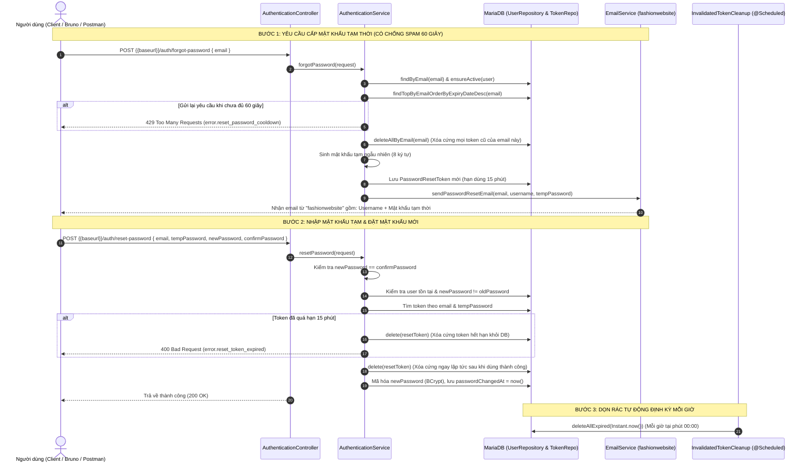

# TÀI LIỆU CHỨC NĂNG QUÊN MẬT KHẨU (FORGOT PASSWORD) - FASHION WEBSITE

Tài liệu này mô tả chi tiết quy trình nghiệp vụ, API endpoints, cách tổ chức mã nguồn, cơ chế chống phình to cơ sở dữ liệu (Database Anti-Bloat & Scheduled Cleanup), chống spam gửi mail liên tục (Cooldown 60s), cơ chế chống rơi vào Thư rác (Anti-Spam) và hướng dẫn cấu hình Email SMTP (Google Gmail) thông qua file `.env` cho chức năng Quên mật khẩu & Đặt lại mật khẩu.

---

## 1. Tổng quan & Quy trình hoạt động

Vì hệ thống đăng nhập (`POST /api/v1/auth/login`) sử dụng **`username`** và **`password`**, nên khi người dùng quên thông tin đăng nhập và nhập **`email`**, hệ thống sẽ gửi về email cả **Tên đăng nhập (`username`)** lẫn **Mật khẩu tạm thời (`tempPassword`)** để người dùng vừa có thể đặt lại mật khẩu mới, vừa biết `username` của mình để đăng nhập lại.



---

## 2. Cơ chế Chống Phình To Database (Anti-Bloat) & Chống Spam (Cooldown)

Để đảm bảo bảng `password_reset_tokens` trong cơ sở dữ liệu MariaDB **không bao giờ bị phình to** theo thời gian và ngăn chặn hành vi spam gửi email liên tục, hệ thống áp dụng **chiến lược 3 lớp xóa cứng (Hard Delete) kết hợp giới hạn tần suất (Rate-Limit Cooldown)**:

### 2.1. Giới hạn tần suất gửi mail (Cooldown 60 giây)
- Khi người dùng gọi `POST /api/v1/auth/forgot-password`, hệ thống kiểm tra token gần nhất của email đó (`findTopByEmailOrderByExpiryDateDesc`).
- Vì mỗi token có thời hạn `15 phút` kể từ lúc tạo, nếu thời điểm hết hạn trừ đi `14 phút` vẫn lớn hơn thời điểm hiện tại (`Instant.now()`), tức là token vừa được tạo **chưa đầy 60 giây trước**.
- Hệ thống lập tức chặn yêu cầu và trả về mã lỗi **`429 Too Many Requests`** (`error.reset_password_cooldown`), giúp bảo vệ hạn ngạch gửi mail (Gmail SMTP quota) và chống spam DB.

### 2.2. Ba lớp tự động làm sạch bảng `password_reset_tokens`
1. **Lớp 1 – Xóa cứng khi yêu cầu mã mới (`deleteAllByEmail`)**:
   - Ngay khi người dùng yêu cầu cấp lại mật khẩu mới (sau thời gian cooldown 60 giây), toàn bộ các bản ghi token cũ của email đó sẽ bị **xóa vật lý (`DELETE`)** khỏi bảng trước khi lưu mã mới. Mỗi email chỉ có tối đa **1 bản ghi duy nhất** đang chờ xác thực trong DB.
2. **Lớp 2 – Xóa cứng ngay sau khi sử dụng (`delete(resetToken)`)**:
   - Khi người dùng đặt lại mật khẩu thành công tại `/auth/reset-password`, bản ghi token được **xóa vật lý ngay lập tức** khỏi DB thay vì giữ lại với cờ `used = true`.
   - Nếu người dùng nhập một mã đã quá hạn 15 phút, hệ thống cũng xóa luôn bản ghi hết hạn đó khỏi DB trước khi trả lỗi `error.reset_token_expired`.
3. **Lớp 3 – Cron Job dọn dẹp tự động mỗi giờ (`InvalidatedTokenCleanup`)**:
   - Đối với trường hợp người dùng bấm "Quên mật khẩu" nhưng sau đó bỏ qua không nhập mã (token bị bỏ rơi trong DB), tiến trình chạy ngầm `InvalidatedTokenCleanup` (`@Scheduled(cron = "0 0 * * * *")`) sẽ tự động chạy vào phút thứ 0 của mỗi giờ để thực thi câu lệnh `DELETE FROM PasswordResetToken t WHERE t.expiryDate < :now`, quét sạch toàn bộ các token đã hết hạn.

> **Kết quả**: Bảng `password_reset_tokens` trong MariaDB luôn chỉ chứa các yêu cầu đang chờ xử lý trong vòng tối đa 15 phút gần nhất, kích thước bảng luôn gần bằng `0`.

---

## 3. Danh sách API Endpoints

> **Lưu ý khi test trên Bruno / Postman**:
> Thiết lập biến môi trường `baseurl = http://localhost:8080/api/v1`

### 3.1. Yêu cầu cấp lại mật khẩu (Gửi Username & Mật khẩu tạm về email)
- **URL**: `{{baseurl}}/auth/forgot-password`
- **Method**: `POST`
- **Auth**: Public (Không yêu cầu Bearer Token)
- **Request Body** (`application/json`):
```json
{
  "email": "nguyenvantruongdz91@gmail.com"
}
```
- **Response Thành công (200 OK)**:
```json
{
  "code": 200,
  "message": "Password reset temporary code has been sent to your email"
}
```
- **Nội dung Email gửi về người dùng**:
  - **Người gửi (From)**: `fashionwebsite`
  - **Tiêu đề (Subject)**: `Mã xác nhận đặt lại mật khẩu - fashionwebsite`
  - **Thông tin trong thư**:
    - **Tên đăng nhập (Username)**: `<username_của_người_dùng>`
    - **Mật khẩu tạm thời**: `<chuỗi_8_ký_tự_ngẫu_nhiên>` (Có hiệu lực trong 15 phút)
- **Mã lỗi thường gặp**:
  - `400 Bad Request`: Định dạng email không hợp lệ (`email: Email should be valid`).
  - `404 Not Found`: Không tìm thấy người dùng với email này (`error.user_not_found`).
  - `403 Forbidden`: Tài khoản đang bị khóa (`error.user_inactive`).
  - `429 Too Many Requests`: Gửi yêu cầu liên tiếp khi chưa qua 60 giây (`error.reset_password_cooldown`).
  - `500 Internal Server Error`: Lỗi kết nối máy chủ gửi email (`error.email_send_failed`).

---

### 3.2. Xác thực mật khẩu tạm và đổi mật khẩu mới
- **URL**: `{{baseurl}}/auth/reset-password`
- **Method**: `POST`
- **Auth**: Public (Không yêu cầu Bearer Token)
- **Request Body** (`application/json`):
```json
{
  "email": "nguyenvantruongdz91@gmail.com",
  "tempPassword": "Xk9mP2qA",
  "newPassword": "MyNewPassword@123",
  "confirmPassword": "MyNewPassword@123"
}
```
- **Response Thành công (200 OK)**:
```json
{
  "code": 200,
  "message": "Password has been reset successfully"
}
```
- **Mã lỗi thường gặp**:
  - `400 Bad Request`:
    - `error.password_confirmation_mismatch`: Mật khẩu xác nhận không khớp với mật khẩu mới.
    - `error.new_password_same_as_old`: Mật khẩu mới không được trùng với mật khẩu cũ hiện tại.
    - `error.reset_token_invalid`: Mật khẩu tạm không chính xác hoặc đã được sử dụng (đã bị xóa sau lần dùng trước).
    - `error.reset_token_expired`: Mật khẩu tạm đã quá hạn 15 phút.
    - Validation error (mật khẩu mới dưới 6 ký tự hoặc để trống).

---

## 4. Hướng dẫn cấu hình Email (Gmail SMTP & File `.env`)

Dự án sử dụng `spring-boot-starter-mail` kết hợp với cấu hình tự động nạp biến môi trường từ file `.env` thông qua dòng `spring.config.import=optional:file:.env[.properties]` trong `application.properties`.

### Bước 1: Tạo Mật khẩu ứng dụng (Google App Password)
1. Đăng nhập vào tài khoản Google dùng làm email gửi hệ thống: [https://myaccount.google.com/](https://myaccount.google.com/)
2. Vào mục **Bảo mật (Security)** -> Bật **Xác minh 2 bước (2-Step Verification)** (nếu chưa bật).
3. Truy cập trang **Mật khẩu ứng dụng (App Passwords)**: [https://myaccount.google.com/apppasswords](https://myaccount.google.com/apppasswords)
4. Nhập tên ứng dụng là `fashionwebsite` -> Nhấn **Tạo (Create)**.
5. Google sẽ sinh chuỗi 16 ký tự (ví dụ: `zqem tgqr knlf cvoe`). Hãy sao chép chuỗi này.

### Bước 2: Khai báo trong file `.env` ở thư mục gốc dự án
Mở file `.env` (tham khảo mẫu tại `.env.example`) và thêm cấu hình sau:

```env
# Mail Configuration (Gmail SMTP)
MAIL_HOST=smtp.gmail.com
MAIL_PORT=587
MAIL_USERNAME=email_gui_cua_ban@gmail.com
MAIL_PASSWORD=zqemtgqrknlfcvoe
MAIL_FROM_NAME=fashionwebsite
```

> **Lưu ý**:
> - `MAIL_PASSWORD` nên viết liền 16 ký tự (không chứa khoảng trắng).
> - Không commit file `.env` lên Git để bảo mật mật khẩu ứng dụng.

### Bước 3: Cấu hình ánh xạ trong `application.properties`
Trong `src/main/resources/application.properties` đã được thiết lập sẵn:

```properties
spring.config.import=optional:file:.env[.properties]

# Mail Configuration (Gmail SMTP)
spring.mail.host=${MAIL_HOST:smtp.gmail.com}
spring.mail.port=${MAIL_PORT:587}
spring.mail.username=${MAIL_USERNAME:}
spring.mail.password=${MAIL_PASSWORD:}
spring.mail.properties.mail.smtp.auth=true
spring.mail.properties.mail.smtp.starttls.enable=true
spring.mail.properties.mail.smtp.starttls.required=true
spring.mail.properties.mail.smtp.connectiontimeout=5000
spring.mail.properties.mail.smtp.timeout=5000
spring.mail.properties.mail.smtp.writetimeout=5000

# Mail Sender Name
app.mail.from-name=${MAIL_FROM_NAME:fashionwebsite}
```

---

## 5. Cơ chế chống rơi vào Thư rác (Anti-Spam Optimization)

Để hạn chế tối đa việc email gửi từ Gmail cá nhân bị bộ lọc của Google đưa vào mục **Thư rác (Spam)**:
1. **Định dạng `multipart/alternative` (Plain-Text + HTML)**: `EmailServiceImpl` sử dụng `helper.setText(plainTextBody, htmlBody)` để gửi kèm đồng thời cả phiên bản văn bản thuần và HTML, giúp vượt qua quy tắc kiểm tra `MIME_HTML_ONLY` của bộ lọc Spam.
2. **Đầy đủ chuẩn Header RFC 5322**: Thiết lập đầy đủ `From`, `Reply-To`, `SentDate` đồng nhất với địa chỉ SMTP xác thực.
3. **Cá nhân hóa nội dung**: Chào đúng `username` của người nhận và sử dụng bố cục HTML chuẩn giao dịch (Transactional Email).
4. **Mẹo trên Gmail người nhận**: Ở lần gửi đầu tiên tới một email mới, nếu thư nằm trong mục **Thư rác (Spam)**, chỉ cần mở thư và nhấn **"Báo cáo không phải thư rác" (Report not spam)** 1 lần duy nhất. Từ các lần sau, Gmail sẽ đưa thẳng thư vào Hộp thư đến (Inbox).

---

## 6. Tổ chức mã nguồn (Code Architecture)

```text
src/main/java/iuh/fit/fashionwebsite/
├── config/
│   └── InvalidatedTokenCleanup.java         # Cron job chạy mỗi giờ xóa cứng các PasswordResetToken đã hết hạn
├── entity/
│   └── PasswordResetToken.java              # Entity lưu bảng password_reset_tokens (tạm thời trong tối đa 15 phút)
├── repository/
│   ├── PasswordResetTokenRepository.java    # Hỗ trợ kiểm tra cooldown, xóa cứng theo email và xóa cứng token hết hạn
│   └── UserRepository.java                  # Bổ sung phương thức findByEmail(String email)
├── dto/request/
│   ├── ForgotPasswordRequest.java           # Validate email yêu cầu cấp lại mật khẩu
│   └── ResetPasswordRequest.java            # Validate email, tempPassword, newPassword, confirmPassword
├── service/
│   ├── email/
│   │   ├── EmailService.java                # Interface sendPasswordResetEmail(toEmail, username, tempPassword)
│   │   └── impl/EmailServiceImpl.java       # Gửi email multipart (Plain-Text + HTML) với tên người gửi "fashionwebsite"
│   └── authentication/
│       └── AuthenticationService.java       # Logic forgotPassword() (cooldown 60s + xóa cũ), resetPassword() (xóa ngay sau dùng)
├── controller/user/
│   └── AuthenticationController.java        # Expose POST /auth/forgot-password và POST /auth/reset-password
└── exception/
    └── ErrorCode.java                       # Mã lỗi RESET_TOKEN_INVALID, RESET_TOKEN_EXPIRED, RESET_PASSWORD_COOLDOWN, EMAIL_SEND_FAILED
```

### Các điểm bảo mật quan trọng:
1. **Bảo vệ mật khẩu hiện tại của người dùng**: Khi gọi `forgot-password`, mật khẩu thật của user **chưa bị ghi đè ngay** (tránh trường hợp người khác nhập email của bạn làm bạn mất quyền đăng nhập). Mật khẩu mới chỉ được cập nhật khi xác thực đúng `tempPassword` ở bước `reset-password`.
2. **Thu hồi phiên đăng nhập cũ**: Khi đổi mật khẩu thành công, trường `passwordChangedAt` của `User` được cập nhật về `Instant.now()`, tự động vô hiệu hóa toàn bộ các Refresh Token phát hành trước thời điểm đó.
3. **Mật khẩu tạm an toàn, dùng 1 lần & tự hủy khỏi DB**: Sinh bằng `SecureRandom` (8 ký tự chữ hoa, chữ thường, số, loại bỏ các ký tự dễ nhìn nhầm như `0/O`, `1/l/I`), tự động hết hạn sau **15 phút**, bị **xóa cứng khỏi DB ngay sau lần dùng đầu tiên** hoặc được Cron Job dọn sạch mỗi giờ.
