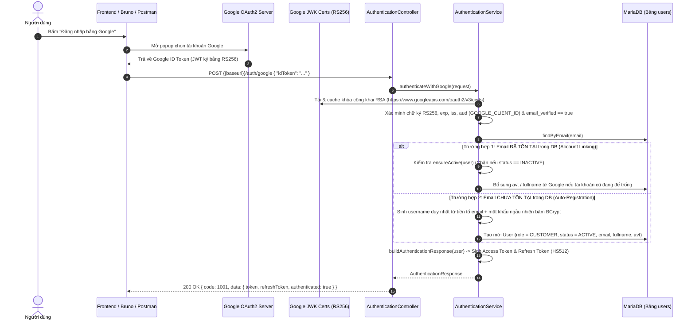

# HƯỚNG DẪN ĐĂNG NHẬP BẰNG GOOGLE (GOOGLE OAUTH2 / OIDC GUIDE)

Tài liệu này cung cấp hướng dẫn toàn diện cho tất cả các thành viên trong nhóm phát triển dự án **Fashion Website** (Backend, Frontend, Tester) về nguyên lý hoạt động, kiến trúc bảo mật, quy tắc xử lý nghiệp vụ (**Account Linking & Auto-Registration**), cách cấu hình Google Cloud Console và cách kiểm thử chức năng **Đăng nhập bằng Google (`POST /api/v1/auth/google`)**.

---

## MỤC LỤC
1. [Tại Sao Chọn Kiến Trúc Google ID Token (OIDC) Cho Dự Án?](#1-tại-sao-chọn-kiến-trúc-google-id-token-oidc-cho-dự-án)
2. [Nguyên Lý Hoạt Động & Luồng Xác Thực (Workflow Architecture)](#2-nguyên-lý-hoạt-động--luồng-xác-thực-workflow-architecture)
3. [Cơ Chế Xác Thực Mật Mã Học 5 Lớp (Cryptographic Verification)](#3-cơ-chế-xác-thực-mật-mã-học-5-lớp-cryptographic-verification)
4. [Nguyên Tắc Xử Lý Nghiệp Vụ & Đồng Bộ Tài Khoản (Business Logic)](#4-nguyên-tắc-xử-lý-nghiệp-vụ--đồng-bộ-tài-khoản-business-logic)
5. [Phân Tích Chi Tiết Code Triển Khai Ở Backend](#5-phân-tích-chi-tiết-code-triển-khai-ở-backend)
6. [Hướng Dẫn Thiết Lập Google Cloud Console & File `.env`](#6-hướng-dẫn-thiết-lập-google-cloud-console--file-env)
7. [Hướng Dẫn Test API Trên Bruno / Postman Bằng OAuth Playground](#7-hướng-dẫn-test-api-trên-bruno--postman-bằng-oauth-playground)
8. [Hướng Dẫn Tích Hợp Cho Thành Viên Làm Frontend (React / Vite)](#8-hướng-dẫn-tích-hợp-cho-thành-viên-làm-frontend-react--vite)
9. [Bảng Mã Lỗi Thường Gặp (Troubleshooting) & Cách Khắc Phục](#9-bảng-mã-lỗi-thường-gặp-troubleshooting--cách-khắc-phục)

---

## 1. Tại Sao Chọn Kiến Trúc Google ID Token (OIDC) Cho Dự Án?

Dự án **Fashion Website** được thiết kế theo kiến trúc **Stateless RESTful API** (Spring Boot ở cổng `8080`, Frontend chạy độc lập ở cổng `3000`/`5173`, xác thực bằng cặp JWT `token` + `refreshToken`).

Thay vì dùng luồng *Server-side Redirect* truyền thống (bắt trình duyệt nhảy qua lại giữa Backend và Google, phụ thuộc vào Cookie/Session dễ gây lỗi CORS), dự án sử dụng chuẩn **OpenID Connect (OIDC) ID Token**:
- **Không cần Session / Cookie:** Giữ nguyên kiến trúc 100% Stateless của dự án.
- **Tái sử dụng trọn vẹn hệ thống JWT hiện có:** Sau khi xác thực Google thành công, Backend cấp lại đúng cặp `token` (Access Token HS512) và `refreshToken` của hệ thống. Mọi tính năng phân quyền (`@PreAuthorize`), `introspect`, `refresh`, `logout` và `InvalidatedToken` hoạt động đồng nhất.
- **Không cần cài thêm thư viện ngoài:** Tận dụng trực tiếp `NimbusJwtDecoder` có sẵn trong `spring-boot-starter-oauth2-resource-server`.
- **Dễ dàng kiểm thử độc lập:** Các thành viên Backend/Tester có thể test trực tiếp bằng **Bruno / Postman** thông qua endpoint `POST {{baseurl}}/auth/google`.

---

## 2. Nguyên Lý Hoạt Động & Luồng Xác Thực (Workflow Architecture)

### 2.1. Sơ Đồ Tổng Quan
```text
[ Người dùng (Browser / App) ]
       │
       │ 1. Bấm nút "Đăng nhập bằng Google" & chọn tài khoản Gmail
       ▼
[ Google Identity Server ]
       │ 2. Xác thực người dùng & ký số vào gói dữ liệu (Claims: email, name, picture, aud, iss)
       │    bằng khóa bí mật RSA (Private Key) của Google -> Trả về chuỗi `idToken` (RS256)
       ▼
[ Frontend / Bruno / Postman ]
       │ 3. Gửi HTTP POST /api/v1/auth/google { "idToken": "eyJhbGciOiJSUzI1Ni..." }
       ▼
[ AuthenticationController -> AuthenticationService ]
       │
       ├── Bước 4: Tải khóa công khai RSA của Google (JWK Set) từ https://www.googleapis.com/oauth2/v3/certs
       │           Kiểm tra chữ ký RS256, thời hạn (exp), nhà phát hành (iss), Client ID (aud) & email_verified
       │
       ├── Bước 5: Tìm người dùng trong bảng `users` theo `email`:
       │           ├── Đã có trong DB -> Kiểm tra trạng thái khóa (ensureActive) -> Liên kết tài khoản (Account Linking)
       │           └── Chưa có trong DB -> Tự động tạo mới User (CUSTOMER, ACTIVE) (Auto-Registration)
       │
       └── Bước 6: Gọi buildAuthenticationResponse(user) -> Sinh cặp JWT (Access Token + Refresh Token)
       │
       ▼
[ Client nhận Response ] -> Lưu Access Token & Refresh Token để gọi các API bảo mật (/users/info, /orders, ...)
```

### 2.2. Sơ Đồ Tuần Tự (Sequence Diagram)


---

## 3. Cơ Chế Xác Thực Mật Mã Học 5 Lớp (Cryptographic Verification)

Một nguyên tắc sống còn trong bảo mật: **Backend tuyệt đối không tin tưởng thông tin email gửi dạng text trần từ Client**, mà chỉ nhận chuỗi **`idToken`** và tự xác minh qua 5 lớp trong `AuthenticationService.verifyGoogleIdToken()`:

| Lớp kiểm tra | Nội dung kiểm tra | Mục đích bảo mật |
| :--- | :--- | :--- |
| **1. Chữ ký số RS256** | Giải mã chữ ký bằng RSA Public Key của Google (`https://www.googleapis.com/oauth2/v3/certs`) | Đảm bảo token do chính Google phát hành, không ai có thể tự chế hoặc sửa đổi `email` bên trong payload |
| **2. Thời hạn (`exp`, `nbf`)** | Kiểm tra thời điểm hết hạn của `idToken` (thường chỉ sống 1 giờ) | Chống tấn công phát lại (Replay Attack) bằng token cũ |
| **3. Nhà phát hành (`iss`)** | Phải khớp `https://accounts.google.com` hoặc `accounts.google.com` | Đảm bảo nguồn phát hành chuẩn từ hệ thống định danh Google |
| **4. Đối tượng nhận (`aud`)** | Phải nằm trong danh sách `GOOGLE_CLIENT_ID` của dự án | Ngăn chặn kẻ tấn công lấy `idToken` cấp cho một trang web khác đem sang hệ thống Fashion Website để đăng nhập |
| **5. Xác minh Email (`email_verified`)** | `email` không rỗng và `email_verified == true` | Đảm bảo địa chỉ email đã được chính chủ xác thực trên Google |

---

## 4. Nguyên Tắc Xử Lý Nghiệp Vụ & Đồng Bộ Tài Khoản (Business Logic)

Trong bảng `users` ([`User.java`](../src/main/java/iuh/fit/fashionwebsite/entity/User.java)), cột `email` được thiết lập `unique = true`. Hệ thống xử lý 3 kịch bản thực tế một cách chặt chẽ:

### Kịch bản 1: Người dùng ĐÃ CÓ tài khoản cùng Email trong hệ thống (Account Linking)
- **Tình huống:** Người dùng từng đăng ký tài khoản bằng form thường (`POST /auth/register`) với email `nguyenvantruongdz91@gmail.com`. Hôm sau họ bấm "Đăng nhập bằng Google" bằng đúng Gmail đó.
- **Cách hệ thống xử lý:**
  1. Tìm thấy tài khoản hiện có qua `userRepository.findByEmail("nguyenvantruongdz91@gmail.com")`.
  2. **Không tạo dòng mới** (tránh lỗi trùng lặp email), mà liên kết thẳng vào tài khoản đó.
  3. **Bảo toàn 100% dữ liệu cũ:** Giữ nguyên `id`, `username`, `passwordHash` cũ, giỏ hàng (`Cart`), lịch sử đơn hàng (`Order`), sổ địa chỉ (`UserAddress`).
  4. **Làm giàu hồ sơ không ghi đè (Non-destructive Enrichment):**
     - Nếu tài khoản cũ chưa có ảnh đại diện (`avt == null/blank`), hệ thống tự động lấy ảnh đại diện từ Google (`picture`) gán vào. Nếu người dùng đã tự upload ảnh lên Cloudinary trước đó thì **giữ nguyên ảnh cũ**.
     - Tương tự với `fullname`: chỉ bổ sung nếu `fullname` đang trống.
  5. **Linh hoạt đăng nhập:** Từ đó về sau, người dùng đăng nhập bằng `username + password` hay bấm nút `Google` đều vào chung một tài khoản duy nhất.

### Kịch bản 2: Người dùng CHƯA TỪNG có tài khoản trong hệ thống (Auto-Registration)
- **Tình huống:** Khách hàng mới tinh lần đầu vào website và bấm "Đăng nhập bằng Google" với email `khachhangmoi@gmail.com`.
- **Cách hệ thống xử lý:**
  1. **Tự động sinh `username` duy nhất:** Lấy phần trước dấu `@` của email (`khachhangmoi`). Nếu `khachhangmoi` đã có người khác dùng làm username, hệ thống tự động nối hậu tố 3 chữ số ngẫu nhiên (`khachhangmoi_482`) cho đến khi không trùng.
  2. **Sinh mật khẩu ngẫu nhiên an toàn:** Tạo chuỗi `UUID.randomUUID()` và băm bằng `BCryptPasswordEncoder` để lưu vào cột `password_hash` (vừa thỏa mãn ràng buộc `nullable = false` của DB, vừa đảm bảo không ai đoán được mật khẩu).
     > 💡 *Mẹo:* Nếu sau này khách hàng muốn đăng nhập bằng `username + password` thông thường, họ chỉ cần dùng chức năng **Quên mật khẩu (`POST /auth/forgot-password`)** — hệ thống sẽ gửi cả `username` lẫn mật khẩu tạm về Gmail cho họ đặt mật khẩu!
  3. **Khởi tạo quyền mặc định:** Gán `role = RoleUser.CUSTOMER`, `status = StatusUser.ACTIVE`, lưu vào DB và trả về cặp token đăng nhập ngay lập tức.

### Kịch bản 3: Tài khoản đã tồn tại nhưng đang bị khóa (`status = INACTIVE`)
- **Tình huống:** Tài khoản vi phạm chính sách và bị Admin khóa (`StatusUser.INACTIVE`), người dùng cố tình bấm "Đăng nhập bằng Google" để lách.
- **Cách hệ thống xử lý:** Ngay khi tìm thấy user theo email, hàm `ensureActive(existingUser)` được kích hoạt và lập tức ném lỗi `AppException(ErrorCode.USER_INACTIVE)` (`403 Forbidden`), từ chối cấp token.

---

## 5. Phân Tích Chi Tiết Code Triển Khai Ở Backend

| Thành phần | Đường dẫn file | Vai trò |
| :--- | :--- | :--- |
| **DTO Request** | [`GoogleLoginRequest.java`](../src/main/java/iuh/fit/fashionwebsite/dto/request/GoogleLoginRequest.java) | Chứa trường `idToken` có gắn `@NotBlank` |
| **Controller** | [`AuthenticationController.java`](../src/main/java/iuh/fit/fashionwebsite/controller/user/AuthenticationController.java) | Endpoint `POST /auth/google` nhận request và trả về `ApiResponse<AuthenticationResponse>` |
| **Service** | [`AuthenticationService.java`](../src/main/java/iuh/fit/fashionwebsite/service/authentication/AuthenticationService.java) | Chứa `authenticateWithGoogle()`, `verifyGoogleIdToken()`, `createGoogleUser()`, `getGoogleJwtDecoder()` |
| **Configuration** | [`application.properties`](../src/main/resources/application.properties) | Khai báo `google.client-id=${GOOGLE_CLIENT_ID:}` |
| **Unit Test** | [`AuthenticationServiceTest.java`](../src/test/java/iuh/fit/fashionwebsite/service/authentication/AuthenticationServiceTest.java) | Kiểm thử đầy đủ các kịch bản: User mới, User cũ, User bị khóa, Token giả/hết hạn |

---

## 6. Hướng Dẫn Thiết Lập Google Cloud Console & File `.env`

> Dịch vụ **Google OAuth 2.0** hoàn toàn **miễn phí 100%** và không yêu cầu thẻ thanh toán quốc tế.

### Bước 1: Tạo `GOOGLE_CLIENT_ID` trên Google Cloud Console
1. Truy cập [Google Cloud Console](https://console.cloud.google.com/) và tạo Project (hoặc chọn Project có sẵn).
2. Vào **APIs & Services** -> **OAuth consent screen**:
   - Chọn **External** -> Điền tên ứng dụng: `FashionWebsite` và email hỗ trợ.
   - Bấm **Publish App** (hoặc thêm email các thành viên nhóm vào danh sách **Test users**).
3. Vào **APIs & Services** -> **Credentials**:
   - Bấm **+ Create Credentials** -> chọn **OAuth client ID**.
   - **Loại ứng dụng (Application type):** Chọn **Ứng dụng web (Web application)**.
   - **Nguồn gốc JavaScript được cho phép (Authorized JavaScript origins):**
     - `http://localhost:3000`
     - `http://localhost:5173`
   - **Các URI chuyển hướng được cho phép (Authorized redirect URIs):**
     - `https://developers.google.com/oauthplayground`
   - Bấm **Tạo (Create)** và sao chép mã **ID máy khách (Client ID)** (có đuôi `.apps.googleusercontent.com`).

### Bước 2: Khai báo trong file `.env`
Mở file `.env` ở thư mục gốc dự án (tham khảo mẫu [`.env.example`](../.env.example)) và thêm:

```env
# Google OAuth2 Client ID
# Nếu muốn vừa chạy với Frontend thật, vừa lấy token test nhanh trên OAuth Playground,
# hãy nối thêm Client ID của OAuth Playground (407408718192.apps.googleusercontent.com) sau dấu phẩy:
GOOGLE_CLIENT_ID=41617839417-5ukvmoerbo0nh0m5gi32r3382g0ntpqb.apps.googleusercontent.com,407408718192.apps.googleusercontent.com
```

---

## 7. Hướng Dẫn Test API Trên Bruno / Postman Bằng OAuth Playground

Khi chưa chạy giao diện Frontend, bất kỳ thành viên nào trong nhóm cũng có thể tự lấy `idToken` thật của Google để test API trên **Bruno / Postman** chỉ trong 30 giây:

### Bước 1: Lấy `id_token` trên Google OAuth 2.0 Playground
1. Mở trình duyệt vào: **[https://developers.google.com/oauthplayground/](https://developers.google.com/oauthplayground/)**
2. Ở cột bên trái (**Step 1: Select & authorize APIs**):
   - Tại ô **"Input your own scopes"** (nằm ngay trên nút màu xanh), gõ chính xác:
     ```text
     openid email profile
     ```
   - Bấm nút **`Authorize APIs`** -> Chọn tài khoản Gmail của bạn để đăng nhập.
3. Chuyển sang **Step 2: Exchange authorization code for tokens**:
   - Bấm nút **`Exchange authorization code for tokens`**.
4. Nhìn sang khung JSON bên phải, kéo xuống dưới cùng và copy toàn bộ chuỗi giá trị của trường **`"id_token"`** (bắt đầu bằng `eyJhbGciOiJSUzI1Ni...`).

### Bước 2: Gửi Request trên Bruno / Postman
- **Method:** `POST`
- **URL:** `{{baseurl}}/auth/google` *(tương ứng `http://localhost:8080/api/v1/auth/google`)*
- **Headers:** `Content-Type: application/json`
- **Body (`JSON`):**
```json
{
  "idToken": "eyJhbGciOiJSUzI1NiIsImtpZCI6Ij..."
}
```
- **Response Thành công (`200 OK`):**
```json
{
  "code": 1001,
  "message": "Google login successfully",
  "data": {
    "token": "eyJhbGciOiJIUzUxMiJ9...",
    "refreshToken": "eyJhbGciOiJIUzUxMiJ9...",
    "authenticated": true
  }
}
```

### Bước 3: Kiểm tra thông tin User vừa đăng nhập
Copy trường `token` trong response ở trên, mở request **`GET {{baseurl}}/users/info`**, dán vào mục **Auth -> Bearer Token** và bấm **Send** để kiểm tra thông tin tài khoản (username, email, fullname, avt) đã được tạo/liên kết tự động trong DB.

---

## 8. Hướng Dẫn Tích Hợp Cho Thành Viên Làm Frontend (React / Vite)

Trên giao diện thực tế, người dùng chỉ cần bấm vào nút Google là thư viện Frontend sẽ tự động lấy `idToken` và gửi xuống Backend:

1. Cài đặt thư viện chính thức cho React:
   ```bash
   npm install @react-oauth/google
   ```
2. Sử dụng trong trang Đăng nhập (`LoginPage.tsx`):
   ```tsx
   import { GoogleOAuthProvider, GoogleLogin } from '@react-oauth/google';
   import axios from 'axios';

   const GOOGLE_CLIENT_ID = "41617839417-5ukvmoerbo0nh0m5gi32r3382g0ntpqb.apps.googleusercontent.com";

   export default function LoginPage() {
     return (
       <GoogleOAuthProvider clientId={GOOGLE_CLIENT_ID}>
         <GoogleLogin
           onSuccess={async (credentialResponse) => {
             // 1. Lấy idToken do Google trả về tự động sau khi người dùng chọn Gmail
             const idToken = credentialResponse.credential;

             // 2. Gửi idToken xuống Backend Spring Boot
             const res = await axios.post('http://localhost:8080/api/v1/auth/google', {
               idToken,
             });

             // 3. Lưu cặp JWT của hệ thống vào bộ nhớ và chuyển hướng
             const { token, refreshToken } = res.data.data;
             localStorage.setItem('accessToken', token);
             localStorage.setItem('refreshToken', refreshToken);
           }}
           onError={() => {
             alert('Đăng nhập bằng Google thất bại!');
           }}
         />
       </GoogleOAuthProvider>
     );
   }
   ```

---

## 9. Bảng Mã Lỗi Thường Gặp (Troubleshooting) & Cách Khắc Phục

| HTTP Status | Message trả về | Nguyên nhân | Cách khắc phục |
| :---: | :--- | :--- | :--- |
| `400` | `idToken: Google ID Token cannot be blank` | Body JSON gửi lên thiếu trường `idToken` hoặc để chuỗi rỗng | Kiểm tra lại key `"idToken"` trong JSON Body |
| `401` | `error.token_invalid` | 1. Bạn copy nhầm `access_token` (`ya29...`) thay vì `id_token` (`eyJ...`)<br>2. `id_token` đã quá hạn 1 giờ<br>3. `aud` trong token không khớp với `GOOGLE_CLIENT_ID` trong `.env` | 1. Copy đúng trường `id_token` (dạng JWT 3 phần)<br>2. Bấm lại *Exchange authorization code* để lấy `id_token` mới<br>3. Nếu test bằng OAuth Playground, thêm `,407408718192.apps.googleusercontent.com` vào `GOOGLE_CLIENT_ID` trong `.env` rồi restart server |
| `401` | `error.unauthenticated` | Tài khoản Google chưa xác minh email (`email_verified = false`) | Sử dụng tài khoản Gmail hợp lệ đã kích hoạt |
| `403` | `error.user_inactive` | Tài khoản có email này trong hệ thống đang ở trạng thái `INACTIVE` (bị khóa) | Mở khóa trạng thái user thành `ACTIVE` trong bảng `users` |
