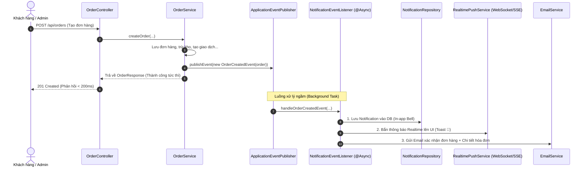

# Tài Liệu Thiết Kế & Hướng Dẫn Triển Khai Hệ Thống Notification (Thông Báo)
> **Dự án:** Fashion Website — Backend (Spring Boot)  
> **Thư mục tài liệu:** `docs/NOTIFICATION.md`  
> **Phiên bản:** 1.0.0  

---

## 1. Tổng Quan (Overview)

Trong một website thương mại điện tử thời trang (**Fashion Website**), hành trình khách hàng kéo dài từ lúc lướt xem hàng, đặt hàng, thanh toán trực tuyến, chờ đóng gói, giao hàng cho đến khi mặc thử và có thể phát sinh nhu cầu đổi trả (size/mẫu).

**Hệ thống Notification (Thông báo)** đóng vai trò là "cầu nối liên lạc thời gian thực" giữa hệ thống với **Khách hàng (Customer)** và đội ngũ **Quản trị / Vận hành (Admin / Staff)**.

### Tác dụng & Giá trị mang lại:
* **Xóa bỏ cảm giác bất an khi mua sắm online:** Khách hàng biết chính xác trạng thái tiền đã trừ chưa, đơn hàng đang ở khâu nào, shipper sắp giao chưa.
* **Tối ưu quy trình đổi trả hàng (`ReturnRequest`):** Đặc thù thời trang đổi size rất nhiều. Thông báo giúp khách biết khi nào yêu cầu được duyệt, khi nào hàng mới được gửi đi hoặc tiền được hoàn về.
* **Tăng tỷ lệ giữ chân (Retention) & Doanh số (Sales):** Nhắc nhở giỏ hàng bị bỏ quên (*Abandoned Cart*), thông báo voucher giảm giá cá nhân hóa (`SpecialOffer`).
* **Vận hành nội bộ tức thời:** Admin/Kho được thông báo ngay khi có đơn hàng mới cần đóng gói, yêu cầu đổi trả cần xử lý, hoặc cảnh báo tồn kho sắp hết (*Low stock*).

---

## 2. Phân Tích & Phân Loại Thông Báo Trong Dự Án

### 2.1. Phân loại theo Đối tượng thụ hưởng

| Đối tượng | Kịch bản thông báo | Mục đích / Tác dụng |
| :--- | :--- | :--- |
| **Khách hàng (Customer)** | **1. Cập nhật đơn hàng:** Đặt thành công, đã duyệt, đang giao, giao thành công, bị hủy.<br>**2. Thanh toán:** Thanh toán online thành công/thất bại, hoàn tiền thành công.<br>**3. Đổi trả hàng (`ReturnRequest`):** Yêu cầu được tiếp nhận, được chấp thuận, bị từ chối.<br>**4. Khuyến mãi & Chăm sóc:** Voucher mới, flash sale, mời đánh giá sản phẩm sau nhận hàng. | Trải nghiệm mua sắm mượt mà, minh bạch, an tâm; kích thích tái mua hàng. |
| **Quản trị viên (Admin / Staff)** | **1. Đơn hàng mới:** Có khách đặt đơn mới cần xác nhận/đóng gói.<br>**2. Yêu cầu đổi trả mới:** Khách gửi yêu cầu đổi size/trả hàng kèm hình ảnh lỗi.<br>**3. Cảnh báo tồn kho:** Biến thể (`ProductVariant`) số lượng tồn kho `< threshold` (vd: < 5 chiếc).<br>**4. Đánh giá xấu:** Review 1-2 sao từ khách hàng cần CSKH can thiệp. | Tối ưu tốc độ xử lý đơn, quản trị kho hàng chính xác, chăm sóc khách hàng kịp thời. |

---

### 2.2. Phân loại theo Kênh truyền dẫn (Channels)

Một hệ thống thông báo chuẩn doanh nghiệp gồm 3 tầng:

```
                  ┌────────────────────────────────────────────────────────┐
                  │                 HỆ THỐNG NOTIFICATION                  │
                  └───────────────────────────┬────────────────────────────┘
                                              │
                ┌─────────────────────────────┼─────────────────────────────┐
                ▼                             ▼                             ▼
   ┌───────────────────────────┐ ┌───────────────────────────┐ ┌───────────────────────────┐
   │    IN-APP NOTIFICATION    │ │     REALTIME POPUP        │ │     EMAIL NOTIFICATION    │
   │  (Lưu DB, Icon Chuông 🔔) │ │   (WebSocket / SSE Push)  │ │      (Spring Boot Mail)   │
   ├───────────────────────────┤ ├───────────────────────────┤ ├───────────────────────────┤
   │ • Lưu trữ lịch sử lâu dài │ • Đẩy tức thời khi online   │ • Gửi các mốc quan trọng    │
   │ • Đếm badge chưa đọc (3)  │ • Toast/Banner trên màn hình│ • Hóa đơn, OTP, xác nhận đơn│
   │ • Deep link tới trang chi │ • Không bỏ lỡ khoảnh khắc   │ • Khách xem lại trong hộp thư│
   │   tiết đơn / đổi trả      │   ngay khi đang duyệt web   │                             │
   └───────────────────────────┘ └───────────────────────────┘ └───────────────────────────┘
```

---

## 3. Kiến Trúc Luồng Hoạt Động (Event-Driven Architecture)

Để **không làm chậm tốc độ phản hồi (Response Time)** của các nghiệp vụ chính (như Đặt hàng, Thanh toán), hệ thống thông báo **bắt buộc phải chạy Bất đồng bộ (Asynchronous)** thông qua **Spring Events**.

### 3.1. Sơ đồ tuần tự (Sequence Diagram)



### 3.2. Ưu điểm của mô hình này:
1. **Decoupling (Tách rời nghiệp vụ):** `OrderService` chỉ lo đúng việc đặt hàng, không cần biết sau đó gửi email gì, push socket thế nào.
2. **Khả năng chịu lỗi cao:** Nếu dịch vụ gửi email hoặc socket gặp sự cố, đơn hàng của khách hàng **vẫn tạo thành công**, không bị rollback vô lý.
3. **Dễ mở rộng:** Khi muốn bổ sung thêm kênh thông báo mới (SMS OTP, Zalo ZNS, Telegram Bot cảnh báo cho Admin), chỉ cần thêm 1 `@EventListener` mới mà không cần sửa code cũ.

---

## 4. Thiết Kế Cơ Sở Dữ Liệu (Database Schema)

### 4.1. Enum `NotificationType`

Tạo enum tại `iuh/fit/fashionwebsite/enums/NotificationType.java`:

```java
package iuh.fit.fashionwebsite.enums;

public enum NotificationType {
    ORDER,            // Cập nhật trạng thái đơn hàng (Pending -> Shipping -> Delivered)
    PAYMENT,          // Giao dịch thanh toán online / Hoàn tiền
    RETURN_REQUEST,   // Tiến trình xử lý đổi size / trả hàng
    PROMOTION,        // Khuyến mãi, Flash Sale, Voucher mới
    INVENTORY,        // Cảnh báo nội bộ: Hết hàng / Tồn kho thấp (Dành cho Admin)
    SYSTEM            // Cảnh báo tài khoản, bảo mật, bảo trì
}
```

---

### 4.2. Bảng `notifications` (Entity Mapping)

Kế thừa `BaseEntity` (đã có `id`, `createdAt`, `updatedAt`):

```java
package iuh.fit.fashionwebsite.entity;

import iuh.fit.fashionwebsite.enums.NotificationType;
import jakarta.persistence.*;
import lombok.*;

import java.time.LocalDateTime;

@Entity
@Table(name = "notifications", indexes = {
    @Index(name = "idx_notifications_recipient_read", columnList = "recipient_id, is_read"),
    @Index(name = "idx_notifications_created_at", columnList = "created_at DESC")
})
@Getter
@Setter
@NoArgsConstructor
@AllArgsConstructor
@Builder
public class Notification extends BaseEntity {

    @ManyToOne(fetch = FetchType.LAZY)
    @JoinColumn(name = "recipient_id", nullable = false)
    private User recipient; // Người nhận thông báo (Customer hoặc Admin)

    @Column(name = "title", nullable = false, length = 200)
    private String title; // Tiêu đề ngắn (ví dụ: "Đơn hàng #DH-1002 đã được giao")

    @Column(name = "content", nullable = false, columnDefinition = "TEXT")
    private String content; // Nội dung mô tả chi tiết

    @Enumerated(EnumType.STRING)
    @Column(name = "type", nullable = false, length = 30)
    private NotificationType type;

    // --- Deep Link & Reference (Hỗ trợ click vào là nhảy đến đúng trang) ---
    @Column(name = "target_url", length = 255)
    private String targetUrl; // URL chuyển hướng FE, ví dụ: "/user/orders/1002"

    @Column(name = "reference_id")
    private Long referenceId; // ID của entity liên quan (order_id, return_request_id...)

    @Column(name = "reference_type", length = 50)
    private String referenceType; // "ORDER", "RETURN_REQUEST", "SPECIAL_OFFER"

    // --- Trạng thái xem ---
    @Column(name = "is_read", nullable = false)
    @Builder.Default
    private boolean isRead = false; // Trạng thái đã đọc hay chưa

    @Column(name = "read_at")
    private LocalDateTime readAt; // Thời điểm người dùng bấm xem
}
```

---

## 5. Danh Sách RESTful API Cần Triển Khai

| STT | Phương thức | Đường dẫn API | Phân quyền | Mô tả chi tiết |
| :---: | :---: | :--- | :---: | :--- |
| **1** | `GET` | `/api/notifications` | User / Admin | Lấy danh sách thông báo của tài khoản hiện tại (phân trang `page`, `size`, lọc theo `isRead`). |
| **2** | `GET` | `/api/notifications/unread-count` | User / Admin | Đếm số lượng thông báo chưa đọc (để hiển thị con số trên icon Quả chuông 🔔). |
| **3** | `PATCH` | `/api/notifications/{id}/read` | User / Admin | Đánh dấu 1 thông báo cụ thể là đã đọc. |
| **4** | `PATCH` | `/api/notifications/read-all` | User / Admin | Đánh dấu tất cả thông báo của user là đã đọc. |
| **5** | `DELETE` | `/api/notifications/{id}` | User / Admin | Xóa 1 thông báo khỏi danh sách. |

### Cấu trúc Response mẫu:

**`GET /api/notifications`**
```json
{
  "code": 200,
  "message": "Lấy danh sách thông báo thành công",
  "data": {
    "content": [
      {
        "id": 15,
        "title": "Đơn hàng #DH-1089 đang được giao",
        "content": "Đơn vị vận chuyển GiaoHangNhanh đang giao kiện hàng của bạn. Hãy chú ý điện thoại từ shipper.",
        "type": "ORDER",
        "targetUrl": "/user/orders/1089",
        "referenceId": 1089,
        "referenceType": "ORDER",
        "isRead": false,
        "createdAt": "2026-10-25T14:30:00"
      }
    ],
    "pageNumber": 0,
    "pageSize": 10,
    "totalElements": 25,
    "totalPages": 3,
    "unreadCount": 3
  }
}
```

---

## 6. Lộ Trình Triển Khai Chi Tiết (Step-by-Step Roadmap)

### Bước 1: Khởi tạo Cấu trúc & Dữ liệu Nền tảng
1. Tạo enum `NotificationType` trong `iuh.fit.fashionwebsite.enums`.
2. Tạo Entity `Notification` trong `iuh.fit.fashionwebsite.entity`.
3. Tạo Repository `NotificationRepository` kế thừa `JpaRepository`:
   * `Page<Notification> findByRecipientIdOrderByCreatedAtDesc(Long recipientId, Pageable pageable);`
   * `long countByRecipientIdAndIsReadFalse(Long recipientId);`
   * `@Modifying @Query("UPDATE Notification n SET n.isRead = true, n.readAt = CURRENT_TIMESTAMP WHERE n.recipient.id = :userId AND n.isRead = false") void markAllAsRead(Long userId);`
4. Tạo các DTO Request / Response trong `iuh.fit.fashionwebsite.dto`.

### Bước 2: Xây dựng Service & Controller cho In-App Notification
1. Tạo `NotificationService` và `NotificationServiceImpl`:
   * Lấy thông báo theo User đang đăng nhập (`SecurityContextHolder`).
   * Kiểm tra quyền sở hữu (tránh lỗi bảo mật IDOR: không cho User A đánh dấu đọc thông báo của User B).
2. Tạo `NotificationController` cung cấp các API như bảng tại Mục 5.

### Bước 3: Cấu hình Bất đồng bộ & Hệ thống Event (Spring Event)
1. Thêm `@EnableAsync` vào file `FashionWebsiteApplication.java` hoặc class cấu hình `AsyncConfig`.
2. Định nghĩa các Event Payload:
   * `OrderStateChangedEvent(Order order, OrderStatus oldStatus, OrderStatus newStatus)`
   * `ReturnRequestEvent(ReturnRequest returnRequest, String message)`
   * `LowStockAlertEvent(ProductVariant variant, int currentStock)`
3. Tạo `NotificationEventListener`:
   * Lắng nghe các event bằng `@EventListener` hoặc `@TransactionalEventListener(phase = TransactionPhase.AFTER_COMMIT)`.
   * Tạo bản ghi `Notification` lưu vào database.

### Bước 4: Tích hợp Real-time Push (WebSocket hoặc SSE)
* **Lựa chọn 1 (Khuyên dùng - Đơn giản & Hiệu quả): Server-Sent Events (SSE)**
  * Endpoint: `GET /api/notifications/stream`
  * Trình duyệt nhận luồng event một chiều từ server qua `EventSource` của Javascript. Rất nhẹ, không cần thư viện phức tạp.
* **Lựa chọn 2: WebSocket + STOMP (Spring WebSocket)**
  * Sử dụng nếu muốn giao tiếp hai chiều hoặc hệ thống đã có tính năng Live Chat.

### Bước 5: Tích hợp Email Notification (Đối với nghiệp vụ trọng yếu)
1. Cấu hình `spring-boot-starter-mail` trong `pom.xml`.
2. Tạo mẫu email HTML bằng Thymeleaf (ví dụ: `order-confirmation-email.html` có logo thương hiệu thời trang, bảng danh sách sản phẩm, size, màu, tổng tiền).
3. Gửi email trong `NotificationEventListener` khi trạng thái đơn hàng là `CONFIRMED` hoặc `DELIVERED`.

---

## 7. Các Lưu Ý Về Hiệu Năng & Bảo Mật (Best Practices)

1. **Bảo mật phân quyền (Prevent IDOR):**
   * Khi đánh dấu đọc hoặc xóa thông báo theo `id`, **luôn luôn xác thực**: `notification.getRecipient().getId().equals(currentUser.getId())`. Nếu không khớp, lập tức ném ngoại lệ `AccessDeniedException` hoặc `ErrorCode.UNAUTHORIZED`.
2. **Đánh Index Database:**
   * Bảng `notifications` tăng trưởng rất nhanh. Bắt buộc phải đánh index kép trên `(recipient_id, is_read)` và `(created_at DESC)` để câu truy vấn đếm số lượng chưa đọc và load trang thông báo luôn đạt thời gian dưới `10ms`.
3. **Chiến lược dọn dẹp dữ liệu (Data Archiving / Cleanup):**
   * Viết một Spring Scheduled Job (`@Scheduled(cron = "0 0 3 * * ?")` chạy lúc 3h sáng hàng ngày):
   * Tự động xóa hoặc archive các thông báo thông thường (khuyến mãi, thông báo đã đọc) cũ hơn **90 ngày** để giữ cho bảng database luôn gọn nhẹ.
4. **Tránh Spam thông báo:**
   * Không push notification liên tục cho cùng một sự kiện. Nếu shipper đang giao hàng nhưng đổi thông tin tài xế thì chỉ cập nhật nội dung chứ không gửi liên tục nhiều notification làm phiền khách.
