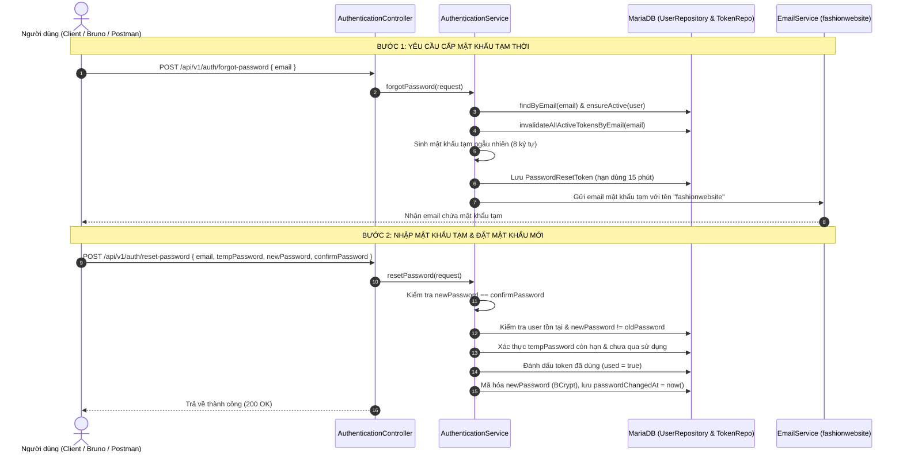

# TÀI LIỆU CHỨC NĂNG QUÊN MẬT KHẨU (FORGOT PASSWORD) - FASHION WEBSITE

Tài liệu này mô tả chi tiết quy trình, API endpoints, cách tổ chức mã nguồn và hướng dẫn cấu hình Email SMTP (Google Gmail) cho chức năng Quên mật khẩu & Đặt lại mật khẩu.

---

## 1. Tổng quan & Quy trình hoạt động

Quy trình đặt lại mật khẩu gồm 2 bước nhằm đảm bảo an toàn tuyệt đối và trải nghiệm thân thiện cho người dùng:



---

## 2. Danh sách API Endpoints

### 2.1. Yêu cầu cấp lại mật khẩu (Gửi mật khẩu tạm về email)
- **URL**: `{{baseurl}}/auth/forgot-password` (Ví dụ: `http://localhost:8080/api/v1/auth/forgot-password`)
- **Method**: `POST`
- **Auth**: Public (Không yêu cầu Bearer Token)
- **Request Body** (`application/json`):
```json
{
  "email": "customer@gmail.com"
}
```
- **Response Thành công (200 OK)**:
```json
{
  "code": 200,
  "message": "Password reset temporary code has been sent to your email",
  "data": null
}
```
- **Mã lỗi thường gặp**:
  - `400 Bad Request`: Định dạng email không hợp lệ (`Email should be valid`).
  - `404 Not Found`: Không tìm thấy người dùng với email này (`error.user_not_found`).
  - `403 Forbidden`: Tài khoản đang bị khóa (`error.user_inactive`).
  - `500 Internal Server Error`: Lỗi kết nối máy chủ gửi email (`error.email_send_failed`).

---

### 2.2. Xác thực và đổi mật khẩu mới
- **URL**: `{{baseurl}}/auth/reset-password` (Ví dụ: `http://localhost:8080/api/v1/auth/reset-password`)
- **Method**: `POST`
- **Auth**: Public (Không yêu cầu Bearer Token)
- **Request Body** (`application/json`):
```json
{
  "email": "customer@gmail.com",
  "tempPassword": "Xk9mP2qA",
  "newPassword": "MyNewPassword@123",
  "confirmPassword": "MyNewPassword@123"
}
```
- **Response Thành công (200 OK)**:
```json
{
  "code": 200,
  "message": "Password has been reset successfully",
  "data": null
}
```
- **Mã lỗi thường gặp**:
  - `400 Bad Request`:
    - `error.password_confirmation_mismatch`: Mật khẩu xác nhận không khớp với mật khẩu mới.
    - `error.new_password_same_as_old`: Mật khẩu mới không được trùng với mật khẩu cũ hiện tại.
    - `error.reset_token_invalid`: Mật khẩu tạm không chính xác hoặc đã được sử dụng.
    - `error.reset_token_expired`: Mật khẩu tạm đã quá hạn 15 phút.
    - Validation error (mật khẩu mới dưới 6 ký tự hoặc để trống).

---

## 3. Hướng dẫn cấu hình Email (Gmail SMTP)

Dự án sử dụng Spring Boot Starter Mail với giao thức SMTP qua cổng TLS 587. Khi gửi email, tên người gửi hiển thị sẽ là **`fashionwebsite`**.

### Bước 1: Tạo Mật khẩu ứng dụng (Google App Password)
Do Google đã chặn tính năng "Cho phép ứng dụng kém an toàn", bạn **bắt buộc** phải tạo Mật khẩu ứng dụng (App Password) 16 ký tự:

1. Đăng nhập vào tài khoản Google bạn muốn dùng làm email gửi: [https://myaccount.google.com/](https://myaccount.google.com/)
2. Vào mục **Bảo mật (Security)** ở cột bên trái.
3. Trong phần "Cách bạn đăng nhập vào Google", bật **Xác minh 2 bước (2-Step Verification)** (nếu chưa bật).
4. Tìm kiếm từ khóa **"Mật khẩu ứng dụng" (App Passwords)** trên thanh tìm kiếm hoặc truy cập thẳng: [https://myaccount.google.com/apppasswords](https://myaccount.google.com/apppasswords)
5. Nhập tên ứng dụng, ví dụ: `fashionwebsite` -> Nhấn **Tạo (Create)**.
6. Google sẽ cung cấp chuỗi mật khẩu 16 chữ cái (dạng `xxxx xxxx xxxx xxxx`). Sao chép chuỗi này (không cần dấu cách).

### Bước 2: Cấu hình vào Dự án

#### Cách 1: Thiết lập Biến môi trường (Khuyên dùng - An toàn nhất)
Đặt các biến môi trường trên máy tính hoặc file `.env` (không commit password lên Git):

- `MAIL_USERNAME`: Địa chỉ email Gmail của bạn (ví dụ: `shopfashionwebsite@gmail.com`).
- `MAIL_PASSWORD`: Mật khẩu ứng dụng 16 ký tự vừa tạo ở Bước 1 (ví dụ: `abcdéfghijklmnop`).
- `MAIL_FROM_NAME`: Tên hiển thị người gửi (mặc định là `fashionwebsite`).

#### Cách 2: Điền trực tiếp vào `application.properties` (Khi test local)
Mở file `src/main/resources/application.properties`:

```properties
# Mail Configuration (Gmail SMTP)
spring.mail.host=smtp.gmail.com
spring.mail.port=587
spring.mail.username=your-gmail-account@gmail.com
spring.mail.password=your-16-char-app-password
spring.mail.properties.mail.smtp.auth=true
spring.mail.properties.mail.smtp.starttls.enable=true
spring.mail.properties.mail.smtp.starttls.required=true
spring.mail.properties.mail.smtp.connectiontimeout=5000
spring.mail.properties.mail.smtp.timeout=5000
spring.mail.properties.mail.smtp.writetimeout=5000

# Tên hiển thị email
app.mail.from-name=fashionwebsite
```

---

## 4. Tổ chức mã nguồn (Code Architecture)

Hệ thống được thiết kế phân tầng chuẩn Clean Architecture của Spring Boot:

```
src/main/java/iuh/fit/fashionwebsite/
├── entity/
│   └── PasswordResetToken.java              # Bảng password_reset_tokens lưu mã tạm thời, email, thời hạn và trạng thái
├── repository/
│   ├── PasswordResetTokenRepository.java    # Truy vấn token hợp lệ và vô hiệu hóa các token cũ
│   └── UserRepository.java                  # Bổ sung phương thức findByEmail(email)
├── dto/request/
│   ├── ForgotPasswordRequest.java           # DTO validate email đầu vào
│   └── ResetPasswordRequest.java            # DTO validate email, tempPassword, newPassword, confirmPassword
├── service/
│   ├── email/
│   │   ├── EmailService.java                # Interface gửi email
│   │   └── impl/EmailServiceImpl.java       # Gửi MimeMessage HTML đẹp mắt với sender name "fashionwebsite"
│   └── authentication/
│       └── AuthenticationService.java       # Logic sinh mã tạm ngẫu nhiên, xác thực mã, đổi mật khẩu và cập nhật passwordChangedAt
├── controller/user/
│   └── AuthenticationController.java        # Endpoint /auth/forgot-password và /auth/reset-password
└── exception/
    └── ErrorCode.java                       # Bổ sung mã lỗi RESET_TOKEN_INVALID, RESET_TOKEN_EXPIRED, EMAIL_SEND_FAILED
```

### Các điểm bảo mật nổi bật:
1. **Chống tấn công Denial-of-Service / Gián đoạn tài khoản**: Mật khẩu hiện tại của người dùng không bị thay đổi ngay khi gọi `forgot-password`. Chỉ khi người dùng thực sự nhập đúng mật khẩu tạm gửi về email ở bước `reset-password`, mật khẩu mới được cập nhật.
2. **Thu hồi phiên đăng nhập cũ**: Sau khi đổi mật khẩu, `passwordChangedAt` được cập nhật về thời điểm hiện tại. Toàn bộ Refresh Token cũ được phát hành trước đó sẽ tự động bị từ chối đăng nhập.
3. **Mã ngẫu nhiên an toàn**: Sử dụng `SecureRandom` để sinh mật khẩu tạm gồm 8 ký tự kết hợp chữ hoa, chữ thường và chữ số, loại bỏ các ký tự dễ gây nhầm lẫn.
4. **Hạn sử dụng ngắn hạn**: Mỗi mã tạm thời chỉ có hiệu lực tối đa 15 phút và là mã sử dụng một lần (One-Time Password).

