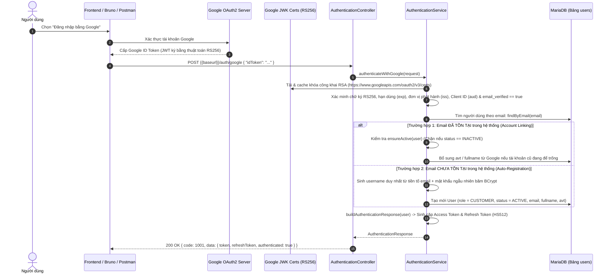

# TÀI LIỆU CHỨC NĂNG ĐĂNG NHẬP BẰNG GOOGLE (GOOGLE OAUTH2 / OIDC) - FASHION WEBSITE

Tài liệu này giải thích chi tiết nguyên lý hoạt động, kiến trúc bảo mật, quy tắc xử lý nghiệp vụ chặt chẽ (Account Linking & Auto-Registration), hướng dẫn thiết lập Google Cloud Console (miễn phí 100%) và cách test trực tiếp trên Bruno / Postman.

---

## 1. Nguyên lý hoạt động & Kiến trúc Bảo mật

Hệ thống triển khai đăng nhập Google theo chuẩn **OpenID Connect (OIDC) ID Token Verification** kết hợp với kiến trúc **Stateless JWT** hiện có của dự án.

### 1.1. Sơ đồ tuần tự (Sequence Diagram)



---

### 1.2. Nguyên lý xác thực mật mã học (Cryptographic Verification)
Khi Client gửi `idToken` lên Backend, hệ thống **không bao giờ tin tưởng mù quáng** vào payload được gửi lên mà thực hiện 5 lớp kiểm tra nghiêm ngặt trong `AuthenticationService.verifyGoogleIdToken()`:
1. **Kiểm tra chữ ký số bất đối xứng (RS256 Signature)**:
   - `NimbusJwtDecoder` tải bộ khóa công khai (Public Keys / JWK Set) chính thức của Google từ `https://www.googleapis.com/oauth2/v3/certs`.
   - Chỉ có máy chủ của Google (nắm giữ Private Key) mới có thể ký ra `idToken` hợp lệ. Bất kỳ sự chỉnh sửa nào trên token đều làm chữ ký thất bại ngay lập tức.
2. **Kiểm tra thời hạn (`exp` & `nbf`)**:
   - Token đã hết hạn sẽ bị từ chối tự động.
3. **Kiểm tra đơn vị phát hành (`iss` - Issuer)**:
   - Bắt buộc `iss` phải là `https://accounts.google.com` hoặc `accounts.google.com`.
4. **Kiểm tra đối tượng thụ hưởng (`aud` - Audience / Client ID)**:
   - Nếu biến môi trường `GOOGLE_CLIENT_ID` được cấu hình, claim `aud` bên trong token bắt buộc phải khớp với `GOOGLE_CLIENT_ID` của dự án (chống tấn công lấy token của ứng dụng khác đem sang ứng dụng này dùng).
5. **Kiểm tra trạng thái xác minh Email (`email_verified`)**:
   - Bắt buộc `email` khác rỗng và `email_verified == true`.

---

## 2. Nguyên tắc xử lý Nghiệp vụ & Dữ liệu (Business Logic)

Trong bảng `users` (`User.java`), cột `email` có ràng buộc `unique = true`. Hệ thống giải quyết bài toán đồng bộ tài khoản theo 3 kịch bản chặt chẽ:

### Kịch bản 1: Người dùng ĐÃ CÓ tài khoản cùng Email trong hệ thống (Account Linking)
- **Tình huống**: Người dùng từng đăng ký tài khoản truyền thống (`POST /auth/register`) với `email = "nguyenvantruongdz91@gmail.com"`, sau đó bấm "Đăng nhập bằng Google" bằng chính Gmail đó.
- **Xử lý**:
  - Hệ thống tìm thấy `User` qua `findByEmail("nguyenvantruongdz91@gmail.com")`.
  - **Không tạo user mới** (tránh lỗi trùng lặp `DUPLICATE_EMAIL`), mà liên kết thẳng vào tài khoản hiện có.
  - **Bảo toàn 100% dữ liệu**: Giữ nguyên `id`, `username`, `passwordHash` cũ, giỏ hàng (`Cart`), đơn hàng (`Order`), địa chỉ (`UserAddress`).
  - **Tự động làm giàu hồ sơ (Profile Enrichment)**: Nếu tài khoản cũ chưa có ảnh đại diện (`avt == null`) hoặc chưa có `fullname`, hệ thống tự động cập nhật ảnh/tên từ Google vào. Nếu người dùng đã có ảnh riêng trên Cloudinary thì giữ nguyên, không ghi đè.

### Kịch bản 2: Người dùng CHƯA TỪNG có tài khoản trong hệ thống (Auto-Registration)
- **Tình huống**: Khách hàng mới lần đầu vào website và bấm "Đăng nhập bằng Google".
- **Xử lý**:
  - Tự động sinh `username` từ phần trước dấu `@` của email (ví dụ: `nguyenvantruongdz91`). Nếu trùng với `username` của người khác đã có trong DB, hệ thống tự động nối thêm hậu tố ngẫu nhiên (`nguyenvantruongdz91_482`) cho đến khi duy nhất.
  - Sinh một mật khẩu ngẫu nhiên `UUID` và băm bằng `BCryptPasswordEncoder` lưu vào `password_hash` (đảm bảo thỏa mãn ràng buộc `nullable = false` của DB và không ai có thể đoán được mật khẩu). Nếu sau này người dùng muốn đăng nhập bằng mật khẩu thường, họ chỉ cần dùng chức năng **Forgot Password**.
  - Gán `role = RoleUser.CUSTOMER` và `status = StatusUser.ACTIVE`.

### Kịch bản 3: Tài khoản đang bị khóa (`status = INACTIVE`)
- **Tình huống**: Tài khoản của người dùng đã bị Admin khóa (`StatusUser.INACTIVE`), người dùng cố tình đăng nhập qua Google để lách.
- **Xử lý**: Hàm `ensureActive(existingUser)` được gọi ngay khi tìm thấy tài khoản và lập tức ném ngoại lệ `AppException(ErrorCode.USER_INACTIVE)` (`403 Forbidden`), chặn hoàn toàn việc cấp token.

---

## 3. Chi tiết API Endpoint

- **URL**: `{{baseurl}}/auth/google` (Ví dụ: `http://localhost:8080/api/v1/auth/google`)
- **Method**: `POST`
- **Auth**: Public (Không cần truyền Bearer Token)
- **Request Body (`application/json`)**:
```json
{
  "idToken": "eyJhbGciOiJSUzI1NiIsImtpZCI6Ij..."
}
```
- **Response Thành công (`200 OK`)**:
```json
{
  "code": 1001,
  "message": "Google login successfully",
  "data": {
    "token": "eyJhbGciOiJIUzUxMiJ9...",
    "refreshToken": "eyJhbGciOiJIUzUxMiJ9...",
    "authenticated": true
  }
}
```
- **Response Lỗi**:
  - `400 Bad Request`: `idToken: Google ID Token cannot be blank`
  - `401 Unauthorized`: `error.token_invalid` (Token Google giả mạo, hết hạn, sai `iss` hoặc sai `aud`)
  - `403 Forbidden`: `error.user_inactive` (Tài khoản đã bị khóa)

---

## 4. Hướng dẫn thiết lập Google Cloud Console (Miễn phí 100%)

1. Truy cập [Google Cloud Console](https://console.cloud.google.com/) bằng tài khoản Gmail của bạn.
2. Tạo một Project mới (ví dụ: `Fashion Website`).
3. Vào menu **APIs & Services** -> **OAuth consent screen**:
   - Chọn **External** -> Bấm **Create**.
   - Điền **App name**: `fashionwebsite`, chọn email hỗ trợ -> Bấm **Save and Continue** qua các bước.
   - Tại mục **Audience / Publishing status**, bạn có thể bấm **Publish App** để cho phép mọi tài khoản Gmail đăng nhập (hoặc thêm email vào **Test users**).
4. Vào menu **APIs & Services** -> **Credentials**:
   - Bấm **+ Create Credentials** -> chọn **OAuth client ID**.
   - **Application type**: Chọn **Web application**.
   - **Authorized JavaScript origins**: Thêm:
     - `http://localhost:3000`
     - `http://localhost:5173`
     - `https://developers.google.com` *(để lấy token test trên OAuth Playground)*
   - **Authorized redirect URIs**: Thêm:
     - `https://developers.google.com/oauthplayground`
   - Bấm **Create** -> Sao chép mã **Client ID** (có dạng `xxxx.apps.googleusercontent.com`).
5. Mở file `.env` ở thư mục gốc dự án và thêm:
   ```env
   GOOGLE_CLIENT_ID=ma_client_id_cua_ban.apps.googleusercontent.com
   ```
   *(Lưu ý: Khi đang test nhanh bằng Google OAuth2 Playground, bạn có thể để trống `GOOGLE_CLIENT_ID=` hoặc điền thêm Client ID của Playground cách nhau bằng dấu phẩy: `GOOGLE_CLIENT_ID=ma_cua_ban,407408718192.apps.googleusercontent.com`).*

---

## 5. Cách lấy `idToken` để Test trực tiếp trên Bruno / Postman (Trong 30 giây)

Bạn không cần đợi có giao diện Frontend mới test được API `POST {{baseurl}}/auth/google`. Hãy làm theo 4 bước sau:

1. Truy cập trang công cụ chính thức của Google: [https://developers.google.com/oauthplayground/](https://developers.google.com/oauthplayground/)
2. Ở cột bên trái (**Step 1: Select & authorize APIs**):
   - Cuộn xuống tìm mục **Google OAuth2 API v2** (hoặc gõ vào ô *Input your own scopes*):
     - Tick chọn cả 3 dòng:
       - `https://www.googleapis.com/auth/userinfo.email`
       - `https://www.googleapis.com/auth/userinfo.profile`
       - `openid`
   - Bấm nút màu xanh **Authorize APIs** và chọn tài khoản Gmail của bạn để đăng nhập.
3. Ở **Step 2: Exchange authorization code for tokens**:
   - Bấm nút **Exchange authorization code for tokens**.
4. Nhìn sang khung kết quả bên phải, copy toàn bộ chuỗi giá trị của trường **`id_token`** (chuỗi bắt đầu bằng `eyJhbGciOiJSUzI1Ni...`).
5. Mở **Bruno / Postman**:
   - Tạo request `POST {{baseurl}}/auth/google`
   - Dán `id_token` vừa copy vào Body JSON:
     ```json
     {
       "idToken": "eyJhbGciOiJSUzI1Ni..."
     }
     ```
   - Bấm **Send** -> Nhận ngay cặp `token` và `refreshToken` của hệ thống!

---

## 6. Danh sách các file mã nguồn liên quan

- **DTO**: [`GoogleLoginRequest.java`](../src/main/java/iuh/fit/fashionwebsite/dto/request/GoogleLoginRequest.java)
- **Service**: [`AuthenticationService.java`](../src/main/java/iuh/fit/fashionwebsite/service/authentication/AuthenticationService.java) (Các phương thức `authenticateWithGoogle`, `verifyGoogleIdToken`, `createGoogleUser`, `getGoogleJwtDecoder`)
- **Controller**: [`AuthenticationController.java`](../src/main/java/iuh/fit/fashionwebsite/controller/user/AuthenticationController.java) (Endpoint `POST /auth/google`)
- **Config**: [`application.properties`](../src/main/resources/application.properties) (`google.client-id=${GOOGLE_CLIENT_ID:}`) & [`.env.example`](../.env.example)
- **Unit Test**: [`AuthenticationServiceTest.java`](../src/test/java/iuh/fit/fashionwebsite/service/authentication/AuthenticationServiceTest.java)

