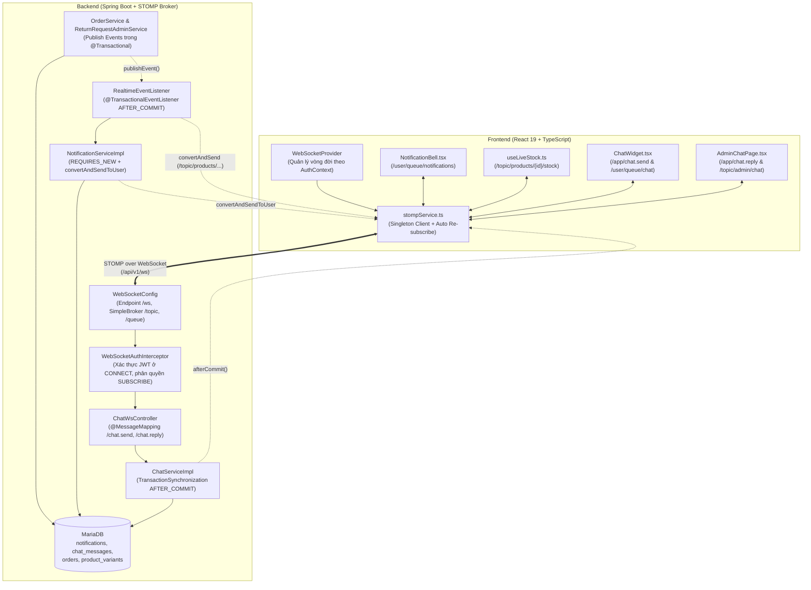

# Tài liệu Kiến trúc & Hiện thực WebSocket (STOMP) – Fashion Website (Spring Boot + React TypeScript)

> **Tài liệu kỹ thuật dành cho Kỹ sư Phát triển & Bảo trì Hệ thống**
> - **Backend**: Spring Boot (`iuh.fit.fashionwebsite`), Java 21, Spring WebSocket + STOMP Simple Broker, Spring Security OAuth2 Resource Server (`CustomJwtDecoder`), Spring Data JPA (MariaDB), MapStruct, Lombok.
> - **Frontend**: React 19 + TypeScript + Vite (`@stomp/stompjs`, Axios với Token Rotation).
> - **Context Path Backend**: `/api/v1` (Port `8081`), Proxy qua Vite (`/api` & `/ws` với `ws: true`).

---

## 1. Tổng quan Phạm vi & Đối chiếu Thực tế Dự án

Hệ thống WebSocket STOMP cung cấp **3 phân hệ thời gian thực (Realtime)** cốt lõi:

1. **Thông báo cá nhân (`Personal Notifications`)**:
   - Khi trạng thái đơn hàng thay đổi (`OrderStatusChangedEvent`) hoặc phiếu trả hàng được tạo/cập nhật (`ReturnRequestCreatedEvent`, `ReturnRequestStatusChangedEvent`), khách hàng nhận thông báo ngay lập tức qua `/user/queue/notifications`.
   - Lưu trữ bền vững trong bảng `notifications` (MariaDB), hỗ trợ đếm số lượng chưa đọc (`unread-count`), đánh dấu đã đọc từng mục hoặc toàn bộ.
2. **Đồng bộ Tồn kho Realtime (`Live Stock Synchronization`)**:
   - Khi có khách đặt hàng (`OrderService.createOrder`) hoặc nhân viên kho nhập lại hàng hoàn trả (`ReturnRequestAdminServiceImpl.restockReturnItems`), sự kiện `StockChangedEvent` được phát ra.
   - Sau khi transaction DB commit thành công (`AFTER_COMMIT`), số lượng tồn kho mới của biến thể (`ProductVariant`) được broadcast tới `/topic/products/{productId}/stock`. Mọi khách hàng đang mở trang `ProductDetailPage` sẽ thấy số lượng tồn kho cập nhật tức thì mà không cần tải lại trang.
3. **Chat Hỗ trợ Khách hàng – Cửa hàng (`Customer – Store Live Chat`)**:
   - Khách hàng gửi tin nhắn qua `/app/chat.send`; tin nhắn được lưu vào bảng `chat_messages` và đẩy về `/user/{customer}/queue/chat` (xác nhận hiển thị cho khách) đồng thời đẩy tới `/topic/admin/chat` cho toàn bộ `ADMIN` / `STAFF` đang trực tuyến.
   - Nhân viên hoặc Admin phản hồi qua `/app/chat.reply` kèm `toUsername`; hệ thống kiểm tra quyền `ROLE_ADMIN` / `ROLE_STAFF`, kiểm tra tài khoản khách tồn tại, lưu DB và đẩy tin nhắn sau khi commit.

---

### 1.1. Bảng Đối chiếu Giả định Tài liệu Gốc và Thực tế Codebase

Để đảm bảo hệ thống chạy chính xác 100% không có lỗi lệch cấu hình, các điểm khác biệt giữa tài liệu tham khảo ban đầu và codebase thực tế đã được chuẩn hóa như sau:

| Hạng mục | Giả định trong bản thảo ban đầu | Thực tế trong Codebase `fashion-website` | Giải pháp đã hiện thực chính xác |
| :--- | :--- | :--- | :--- |
| **`BaseEntity`** | Giả định `BaseEntity` có sẵn `id` (`Long`), `createdAt`, `updatedAt`. | [BaseEntity.java](file:///e:/LapTrinhWWW_BTL/fashion-website/src/main/java/iuh/fit/fashionwebsite/entity/BaseEntity.java) chỉ có `createdAt` và `updatedAt` (`LocalDateTime`), **không** khai báo `id`. | Khai báo rõ `@Id @GeneratedValue(strategy = GenerationType.IDENTITY) private Long id;` trong `Notification` và `ChatMessage`. |
| **Context Path & Port** | Giả định cổng `8080`, không có context-path (`ws://localhost:8080/ws`). | `server.port=8081` và `server.servlet.context-path=/api/v1`. | Handshake endpoint hoạt động tại `/api/v1/ws`. Cấu hình Vite Proxy bật `ws: true` cho cả `/api` và `/ws` để hỗ trợ cả `localhost:5173` và `ngrok` (`wss://`). |
| **Wrapper REST `ApiResponse<T>`** | Giả định wrapper dạng `{ code, result }`. | [ApiResponse.java](file:///e:/LapTrinhWWW_BTL/fashion-website/src/main/java/iuh/fit/fashionwebsite/dto/response/ApiResponse.java) của dự án dùng `{ code, message, data }`. | Các REST Controller (`NotificationController`, `ChatController`, `OrderController`) trả về chuẩn `ApiResponse<T>` với trường `data` đồng bộ toàn hệ thống. |
| **JWT Claim & Role** | `Principal.getName()` = `sub`; quyền là `ROLE_ADMIN`, `ROLE_STAFF`. | `AuthenticationService` sinh `sub = user.getUsername()`, claim `scope` được `SecurityConfig.jwtAuthenticationConverter()` gắn tiền tố `ROLE_`. | Tái sử dụng trực tiếp bean `CustomJwtDecoder` (kiểm tra cả chữ ký HS512, thời hạn, `TokenType.ACCESS`, và bảng `invalidated_tokens`) cùng `JwtAuthenticationConverter` trong `WebSocketAuthInterceptor`. |
| **Tên trường tồn kho của `ProductVariant`** | Giả định `variant.getStock()`. | [ProductVariant.java](file:///e:/LapTrinhWWW_BTL/fashion-website/src/main/java/iuh/fit/fashionwebsite/entity/ProductVariant.java) dùng `stockQuantity` (`Integer`). | Ánh xạ chính xác `variant.getStockQuantity()` sang `StockChangedEvent` và `StockUpdateResponse.stock` cho Frontend. |

---

## 2. Kiến trúc Luồng Dữ liệu & Quy ước STOMP Destination

### 2.1. Sơ đồ Kiến trúc Tổng thể



### 2.2. Bảng Quy ước STOMP Destination

| STT | Destination | Hướng | Quyền hạn (Role) | Payload DTO | Mô tả chức năng |
| :-: | :--- | :---: | :--- | :--- | :--- |
| 1 | `/app/chat.send` | Client → Server | `CUSTOMER`, `ADMIN`, `STAFF` (Authenticated) | `ChatMessageSendRequest` | Khách hàng gửi tin nhắn hỗ trợ mới tới cửa hàng |
| 2 | `/app/chat.reply` | Client → Server | `ADMIN`, `STAFF` | `ChatMessageReplyRequest` | Nhân viên/Admin phản hồi tin nhắn cho một khách hàng (`toUsername`) |
| 3 | `/user/queue/notifications` | Server → Client | Cá nhân từng User (`Principal.getName()`) | `NotificationResponse` | Kênh nhận thông báo cá nhân thời gian thực (đơn hàng, trả hàng, hệ thống) |
| 4 | `/user/queue/chat` | Server → Client | Cá nhân từng Khách hàng | `ChatMessageResponse` | Kênh nhận tin nhắn hai chiều trong hội thoại của chính khách hàng đó |
| 5 | `/user/queue/errors` | Server → Client | Cá nhân từng User | `WsErrorResponse` | Kênh nhận thông báo lỗi khi gửi frame STOMP (`@MessageExceptionHandler`) |
| 6 | `/topic/products/{productId}/stock` | Server → Client | Tất cả User đã kết nối | `StockUpdateResponse` | Kênh broadcast tồn kho mới nhất của biến thể sản phẩm khi có đơn đặt/nhập kho |
| 7 | `/topic/admin/chat` | Server → Client | Chỉ `ADMIN`, `STAFF` (chặn ở `SUBSCRIBE`) | `ChatMessageResponse` | Kênh đồng bộ toàn bộ tin nhắn hỗ trợ (cả chiều khách gửi và nhân viên trả lời) |

---

## 3. Chi tiết Thiết kế & Cấu trúc File Backend

### 3.1. Danh mục File Backend đã hiện thực

- **Cấu hình & Bảo mật**:
  - [WebSocketConfig.java](file:///e:/LapTrinhWWW_BTL/fashion-website/src/main/java/iuh/fit/fashionwebsite/config/WebSocketConfig.java): Đăng ký STOMP endpoint `/ws` (kèm context-path là `/api/v1/ws`), cấu hình `SimpleBroker` (`/topic`, `/queue`) với heartbeat `[10000, 10000]`, giới hạn kích thước frame `64KB`, buffer `512KB`, timeout `20s`.
  - [SecurityConfig.java](file:///e:/LapTrinhWWW_BTL/fashion-website/src/main/java/iuh/fit/fashionwebsite/config/SecurityConfig.java): Cho phép handshake HTTP `/ws/**` (`permitAll`), bảo vệ `/admin/chat/**` và `/api/admin/chat/**` với `hasAnyRole("ADMIN", "STAFF")`, public bean `jwtAuthenticationConverter()`.
  - [WebSocketAuthInterceptor.java](file:///e:/LapTrinhWWW_BTL/fashion-website/src/main/java/iuh/fit/fashionwebsite/security/WebSocketAuthInterceptor.java):
    - Ở frame `StompCommand.CONNECT`: Đọc native header `Authorization: Bearer <token>`, giải mã qua `CustomJwtDecoder` (kiểm tra chữ ký, hạn dùng, `TokenType.ACCESS`, blacklist `invalidated_tokens`) và gắn `Authentication` vào session WebSocket (`accessor.setUser(...)`).
    - Ở frame `StompCommand.SUBSCRIBE`: Chặn tuyệt đối tài khoản không có quyền `ROLE_ADMIN` / `ROLE_STAFF` khi cố tình subscribe vào `/topic/admin/**`.
  - [WsSecurityUtils.java](file:///e:/LapTrinhWWW_BTL/fashion-website/src/main/java/iuh/fit/fashionwebsite/security/WsSecurityUtils.java): Tiện ích kiểm tra nhanh `ROLE_ADMIN` hoặc `ROLE_STAFF` từ `Principal`.
- **Thực thể (Entities), Enums & Repositories**:
  - [NotificationType.java](file:///e:/LapTrinhWWW_BTL/fashion-website/src/main/java/iuh/fit/fashionwebsite/enums/NotificationType.java) & [ChatRole.java](file:///e:/LapTrinhWWW_BTL/fashion-website/src/main/java/iuh/fit/fashionwebsite/enums/ChatRole.java)
  - [Notification.java](file:///e:/LapTrinhWWW_BTL/fashion-website/src/main/java/iuh/fit/fashionwebsite/entity/Notification.java) & [ChatMessage.java](file:///e:/LapTrinhWWW_BTL/fashion-website/src/main/java/iuh/fit/fashionwebsite/entity/ChatMessage.java)
  - [NotificationRepository.java](file:///e:/LapTrinhWWW_BTL/fashion-website/src/main/java/iuh/fit/fashionwebsite/repository/NotificationRepository.java) & [ChatMessageRepository.java](file:///e:/LapTrinhWWW_BTL/fashion-website/src/main/java/iuh/fit/fashionwebsite/repository/ChatMessageRepository.java)
- **DTOs & MapStruct Mappers**:
  - Requests: [ChatMessageSendRequest.java](file:///e:/LapTrinhWWW_BTL/fashion-website/src/main/java/iuh/fit/fashionwebsite/dto/request/ChatMessageSendRequest.java), [ChatMessageReplyRequest.java](file:///e:/LapTrinhWWW_BTL/fashion-website/src/main/java/iuh/fit/fashionwebsite/dto/request/ChatMessageReplyRequest.java), [OrderStatusUpdateRequest.java](file:///e:/LapTrinhWWW_BTL/fashion-website/src/main/java/iuh/fit/fashionwebsite/dto/request/OrderStatusUpdateRequest.java)
  - Responses: [NotificationResponse.java](file:///e:/LapTrinhWWW_BTL/fashion-website/src/main/java/iuh/fit/fashionwebsite/dto/response/NotificationResponse.java), [ChatMessageResponse.java](file:///e:/LapTrinhWWW_BTL/fashion-website/src/main/java/iuh/fit/fashionwebsite/dto/response/ChatMessageResponse.java), [StockUpdateResponse.java](file:///e:/LapTrinhWWW_BTL/fashion-website/src/main/java/iuh/fit/fashionwebsite/dto/response/StockUpdateResponse.java), [WsErrorResponse.java](file:///e:/LapTrinhWWW_BTL/fashion-website/src/main/java/iuh/fit/fashionwebsite/dto/response/WsErrorResponse.java)
  - Mappers: [NotificationMapper.java](file:///e:/LapTrinhWWW_BTL/fashion-website/src/main/java/iuh/fit/fashionwebsite/mapper/NotificationMapper.java), [ChatMessageMapper.java](file:///e:/LapTrinhWWW_BTL/fashion-website/src/main/java/iuh/fit/fashionwebsite/mapper/ChatMessageMapper.java)
- **Events & Services (Đảm bảo gửi sau `AFTER_COMMIT`)**:
  - [OrderStatusChangedEvent.java](file:///e:/LapTrinhWWW_BTL/fashion-website/src/main/java/iuh/fit/fashionwebsite/event/OrderStatusChangedEvent.java) & [StockChangedEvent.java](file:///e:/LapTrinhWWW_BTL/fashion-website/src/main/java/iuh/fit/fashionwebsite/event/StockChangedEvent.java)
  - [RealtimeEventListener.java](file:///e:/LapTrinhWWW_BTL/fashion-website/src/main/java/iuh/fit/fashionwebsite/event/RealtimeEventListener.java): Sử dụng `@TransactionalEventListener(phase = TransactionPhase.AFTER_COMMIT, fallbackExecution = true)` lắng nghe thay đổi đơn hàng, tồn kho và yêu cầu trả hàng.
  - [NotificationServiceImpl.java](file:///e:/LapTrinhWWW_BTL/fashion-website/src/main/java/iuh/fit/fashionwebsite/service/notification/NotificationServiceImpl.java): Dùng `@Transactional(propagation = Propagation.REQUIRES_NEW)` trong hàm `push(...)` vì tại thời điểm `AFTER_COMMIT`, transaction gốc đã đóng nên cần mở transaction mới để lưu `Notification` xuống DB trước khi đẩy qua `SimpMessagingTemplate`.
  - [ChatServiceImpl.java](file:///e:/LapTrinhWWW_BTL/fashion-website/src/main/java/iuh/fit/fashionwebsite/service/chat/ChatServiceImpl.java): Sử dụng `TransactionSynchronizationManager.registerSynchronization` (`afterCommit()`) để đảm bảo tin nhắn đã được lưu vào bảng `chat_messages` thành công rồi mới phát qua `/user/{customer}/queue/chat` và `/topic/admin/chat`.
  - [OrderService.java](file:///e:/LapTrinhWWW_BTL/fashion-website/src/main/java/iuh/fit/fashionwebsite/service/order/OrderService.java): Khi tạo đơn (`createOrder`) sẽ trừ tồn kho từng biến thể, phát `StockChangedEvent` và `OrderStatusChangedEvent`; khi cập nhật trạng thái đơn (`updateStatus`) sẽ phát `OrderStatusChangedEvent`.
- **Controllers**:
  - [ChatWsController.java](file:///e:/LapTrinhWWW_BTL/fashion-website/src/main/java/iuh/fit/fashionwebsite/controller/chat/ChatWsController.java)
  - [NotificationController.java](file:///e:/LapTrinhWWW_BTL/fashion-website/src/main/java/iuh/fit/fashionwebsite/controller/notification/NotificationController.java)
  - [ChatController.java](file:///e:/LapTrinhWWW_BTL/fashion-website/src/main/java/iuh/fit/fashionwebsite/controller/chat/ChatController.java)
  - [OrderController.java](file:///e:/LapTrinhWWW_BTL/fashion-website/src/main/java/iuh/fit/fashionwebsite/controller/order/OrderController.java)

---

## 4. Chi tiết Thiết kế & Cấu trúc File Frontend

### 4.1. Danh mục File Frontend đã hiện thực

- **Tầng Hạ tầng Kết nối STOMP (`src/ws/`)**:
  - [stompService.ts](file:///e:/LapTrinhWWW_BTL/fashion-website-frontend/src/ws/stompService.ts):
    - Duy trì **một kết nối WebSocket duy nhất (Singleton)** cho toàn ứng dụng.
    - Tự động suy luận URL WebSocket (`ws://` hoặc `wss://` khi chạy qua HTTPS/ngrok) từ `VITE_WS_URL` (`/api/v1/ws`).
    - Callback `beforeConnect` luôn lấy `localStorage.getItem(TOKEN_KEY)` mới nhất trước mỗi lần kết nối hoặc tự động kết nối lại (`reconnectDelay: 5000`).
    - Lưu danh sách các `subscriptions` trong `Map` để khi mất mạng và kết nối lại (`onConnect`), toàn bộ các component đang mở sẽ được **tự động subscribe lại** mà không mất sự kiện.
  - [useStompSubscription.ts](file:///e:/LapTrinhWWW_BTL/fashion-website-frontend/src/ws/useStompSubscription.ts): Hook tự động đăng ký và hủy đăng ký (`unsubscribe`) khi component mount/unmount, giữ `handlerRef` luôn mới nhất mà không gây re-subscribe thừa.
  - [WebSocketProvider.tsx](file:///e:/LapTrinhWWW_BTL/fashion-website-frontend/src/ws/WebSocketProvider.tsx): Bọc quanh `<App />` bên trong `<AuthProvider>` tại [main.tsx](file:///e:/LapTrinhWWW_BTL/fashion-website-frontend/src/main.tsx); tự động kích hoạt `stompService.connect` khi `isAuthenticated === true` và ngắt kết nối ngay khi `logout`.
- **Tầng Giao diện & Nghiệp vụ Realtime**:
  - [NotificationBell.tsx](file:///e:/LapTrinhWWW_BTL/fashion-website-frontend/src/components/layout/NotificationBell.tsx): Chuông thông báo trên thanh [Header.tsx](file:///e:/LapTrinhWWW_BTL/fashion-website-frontend/src/components/layout/Header.tsx), tự động tải lại danh sách + số chưa đọc mỗi khi `status === 'CONNECTED'`, lắng nghe `/user/queue/notifications` để chèn thông báo mới lên đầu danh sách và tăng bộ đếm tức thì.
  - [useLiveStock.ts](file:///e:/LapTrinhWWW_BTL/fashion-website-frontend/src/components/product/useLiveStock.ts): Hook lắng nghe `/topic/products/${productId}/stock`, tích hợp trực tiếp vào [ProductDetailPage.tsx](file:///e:/LapTrinhWWW_BTL/fashion-website-frontend/src/pages/ProductDetailPage.tsx) để cập nhật số lượng tồn kho của từng màu/size ngay lập tức.
  - [ChatWidget.tsx](file:///e:/LapTrinhWWW_BTL/fashion-website-frontend/src/components/chat/ChatWidget.tsx): Hộp chat nổi cho khách hàng ở góc dưới bên phải màn hình, hợp nhất tin nhắn lịch sử (`GET /api/v1/chat/history`) và tin nhắn realtime (`/user/queue/chat`) qua hàm `mergeById` ([chat.ts](file:///e:/LapTrinhWWW_BTL/fashion-website-frontend/src/utils/chat.ts)) chống trùng lặp.
  - [AdminChatPage.tsx](file:///e:/LapTrinhWWW_BTL/fashion-website-frontend/src/pages/AdminChatPage.tsx): Trang quản trị hội thoại trực tuyến (`/admin/chat`) dành cho `ADMIN` và `STAFF`, tích hợp thêm công cụ cập nhật trạng thái đơn hàng để kiểm thử trực tiếp luồng bắn thông báo `OrderStatusChangedEvent`.

---

## 5. Danh sách Kiểm tra Endpoint & Destination (API & WebSocket Specification Checklist)

### 5.1. Bảng RESTful API Endpoints (Hỗ trợ Realtime, Thông báo, Chat & Đơn hàng)

| STT | Module | Method | Endpoint URL | Quyền hạn (Role) | Trạng thái | Request Body / Params | Response DTO | Mô tả chức năng | Đã hiện thực |
| :-: | :--- | :---: | :--- | :--- | :---: | :--- | :--- | :--- | :---: |
| 1 | Notifications | `GET` | `/api/v1/notifications` | `ADMIN`, `STAFF`, `CUSTOMER` | **HIỆN CÓ** | `page` (default `0`), `size` (default `20`, max `50`) | `Page<NotificationResponse>` | Lấy danh sách thông báo cá nhân của người dùng đang đăng nhập (mới nhất trước) | **Hoàn thành** |
| 2 | Notifications | `GET` | `/api/v1/notifications/unread-count` | `ADMIN`, `STAFF`, `CUSTOMER` | **HIỆN CÓ** | Không | `Map<String, Long>` (`{ count }`) | Đếm tổng số lượng thông báo chưa đọc của người dùng hiện tại | **Hoàn thành** |
| 3 | Notifications | `PATCH` | `/api/v1/notifications/{id}/read` | `ADMIN`, `STAFF`, `CUSTOMER` | **HIỆN CÓ** | PathVariable: `id` (`Long`) | `Void` | Đánh dấu một thông báo cụ thể của người dùng là đã đọc (`seen = true`) | **Hoàn thành** |
| 4 | Notifications | `PATCH` | `/api/v1/notifications/read-all` | `ADMIN`, `STAFF`, `CUSTOMER` | **HIỆN CÓ** | Không | `Void` | Đánh dấu toàn bộ thông báo chưa đọc của người dùng hiện tại thành đã đọc | **Hoàn thành** |
| 5 | Chat | `GET` | `/api/v1/chat/history` | `ADMIN`, `STAFF`, `CUSTOMER` | **HIỆN CÓ** | Không | `List<ChatMessageResponse>` | Lấy tối đa 100 tin nhắn gần nhất trong hội thoại hỗ trợ của khách hàng đang đăng nhập (sắp xếp cũ → mới) | **Hoàn thành** |
| 6 | Admin Chat | `GET` | `/api/v1/admin/chat/conversations` | `ADMIN`, `STAFF` | **HIỆN CÓ** | Không | `List<String>` | Lấy danh sách `username` của các khách hàng đã nhắn tin, sắp xếp theo tin nhắn mới nhất | **Hoàn thành** |
| 7 | Admin Chat | `GET` | `/api/v1/admin/chat/{username}` | `ADMIN`, `STAFF` | **HIỆN CÓ** | PathVariable: `username` (`String`) | `List<ChatMessageResponse>` | Lấy lịch sử tin nhắn hỗ trợ của một khách hàng cụ thể dành cho Admin/Staff | **Hoàn thành** |
| 8 | Orders (Realtime Trigger) | `POST` | `/api/v1/orders` | `ADMIN`, `STAFF`, `CUSTOMER` | **HIỆN CÓ** | `OrderCreationRequest` (`userAddressId`, `paymentMethodId`) | `OrderResponse` | Đặt hàng từ giỏ hàng, trừ tồn kho `ProductVariant` và phát `StockChangedEvent` + `OrderStatusChangedEvent` | **Hoàn thành** |
| 9 | Orders (Realtime Trigger) | `PATCH` / `PUT` | `/api/v1/orders/{id}/status` | `ADMIN`, `STAFF` | **HIỆN CÓ** | PathVariable: `id`, Body: `OrderStatusUpdateRequest` (`status`) | `OrderResponse` | Cập nhật trạng thái đơn hàng và phát `OrderStatusChangedEvent` đẩy thông báo realtime cho khách | **Hoàn thành** |
| 10 | Orders | `GET` | `/api/v1/orders/my-orders` | `ADMIN`, `STAFF`, `CUSTOMER` | **HIỆN CÓ** | Không | `List<OrderResponse>` | Lấy danh sách đơn hàng của người dùng đang đăng nhập | **Hoàn thành** |

---

### 5.2. Bảng WebSocket (STOMP) Handshake & Message Destinations

| STT | Module | Method / Frame | Endpoint / Destination | Quyền hạn (Role) | Trạng thái | Payload / Header | Response / Broadcast DTO | Mô tả chức năng | Đã hiện thực |
| :-: | :--- | :---: | :--- | :--- | :---: | :--- | :--- | :--- | :---: |
| 11 | WebSocket Handshake | `GET` (Upgrade) | `/api/v1/ws` (và `/ws` qua proxy) | Public Handshake + JWT ở `CONNECT` | **HIỆN CÓ** | Native Header: `Authorization: Bearer <access_token>` | Frame `CONNECTED` | Khởi tạo kết nối STOMP over WebSocket, xác thực JWT qua `CustomJwtDecoder` và gắn `Principal` | **Hoàn thành** |
| 12 | WebSocket Chat | `SEND` (`@MessageMapping`) | `/app/chat.send` | `CUSTOMER`, `ADMIN`, `STAFF` | **HIỆN CÓ** | `ChatMessageSendRequest` (`{ content }`) | Đẩy về `/user/queue/chat` & `/topic/admin/chat` | Khách hàng gửi tin nhắn hỗ trợ, lưu DB và phát realtime sau khi transaction commit | **Hoàn thành** |
| 13 | WebSocket Chat | `SEND` (`@MessageMapping`) | `/app/chat.reply` | `ADMIN`, `STAFF` | **HIỆN CÓ** | `ChatMessageReplyRequest` (`{ toUsername, content }`) | Đẩy về `/user/{toUsername}/queue/chat` & `/topic/admin/chat` | Nhân viên/Admin trả lời khách hàng cụ thể, kiểm tra quyền và phát realtime sau khi commit | **Hoàn thành** |
| 14 | WebSocket Notification | `SUBSCRIBE` | `/user/queue/notifications` | Cá nhân từng User | **HIỆN CÓ** | Không | `NotificationResponse` | Kênh nhận thông báo đơn hàng, trả hàng, khuyến mãi thời gian thực của từng tài khoản | **Hoàn thành** |
| 15 | WebSocket Chat | `SUBSCRIBE` | `/user/queue/chat` | Cá nhân từng Khách | **HIỆN CÓ** | Không | `ChatMessageResponse` | Kênh nhận tin nhắn hội thoại hỗ trợ của riêng khách hàng đó | **Hoàn thành** |
| 16 | WebSocket Error | `SUBSCRIBE` | `/user/queue/errors` | Cá nhân từng User | **HIỆN CÓ** | Không | `WsErrorResponse` (`{ message }`) | Kênh nhận thông báo lỗi khi gửi frame STOMP không hợp lệ hoặc không đủ quyền | **Hoàn thành** |
| 17 | WebSocket Live Stock | `SUBSCRIBE` | `/topic/products/{productId}/stock` | Tất cả User đã kết nối | **HIỆN CÓ** | Path param: `productId` | `StockUpdateResponse` (`{ productId, variantId, stock }`) | Kênh nhận cập nhật số lượng tồn kho sản phẩm tức thì khi có khách đặt hàng hoặc kho nhập lại hàng hoàn | **Hoàn thành** |
| 18 | WebSocket Admin Chat | `SUBSCRIBE` | `/topic/admin/chat` | Chỉ `ADMIN`, `STAFF` | **HIỆN CÓ** | Không (Chặn ở `WebSocketAuthInterceptor`) | `ChatMessageResponse` | Kênh giám sát và đồng bộ mọi tin nhắn chat hỗ trợ theo thời gian thực cho toàn bộ Admin/Staff | **Hoàn thành** |

---

## 6. Hướng dẫn Kiểm thử & Bảo trì dành cho Kỹ sư

### 6.1. Chạy Kiểm thử Tự động Backend (JUnit 5 + Mockito)
Bộ kiểm thử đơn vị [WebSocketAndRealtimeTest.java](file:///e:/LapTrinhWWW_BTL/fashion-website/src/test/java/iuh/fit/fashionwebsite/websocket/WebSocketAndRealtimeTest.java) kiểm tra toàn diện 8 kịch bản bảo mật và nghiệp vụ:
```powershell
.\mvnw.cmd test "-Dtest=WebSocketAndRealtimeTest"
```
Bao gồm:
1. `connectWithoutToken_throwsMessagingException`: Chặn `CONNECT` thiếu header `Authorization`.
2. `connectWithInvalidToken_throwsMessagingException`: Chặn `CONNECT` khi token giả mạo/hết hạn/đã logout.
3. `connectWithValidToken_setsAuthenticatedPrincipal`: Gắn đúng `Principal` (`sub` = `username`) và `ROLE_*`.
4. `customerSubscribeToAdminTopic_throwsMessagingException`: Chặn `CUSTOMER` nghe lén `/topic/admin/chat`.
5. `adminSubscribeToAdminTopic_succeeds`: Cho phép `ADMIN`/`STAFF` subscribe `/topic/admin/chat`.
6. `orderStatusEvent_pushesRealtimeNotificationToCustomer`: Kiểm chứng `OrderStatusChangedEvent` lưu DB và bắn về `/user/{username}/queue/notifications`.
7. `stockChangedEvent_broadcastsRealtimeStockToTopic`: Kiểm chứng `StockChangedEvent` phát tới `/topic/products/{productId}/stock`.
8. `chatSendAndReply_deliversToCustomerQueueAndAdminTopic`: Kiểm chứng gửi tin nhắn 2 chiều và chặn `CUSTOMER` gọi `/app/chat.reply`.

### 6.2. Quy trình Bảo trì & Mở rộng trong Tương lai
- **Thêm loại thông báo mới**:
  1. Bổ sung hằng số vào enum [NotificationType.java](file:///e:/LapTrinhWWW_BTL/fashion-website/src/main/java/iuh/fit/fashionwebsite/enums/NotificationType.java) và union type `NotificationType` trong [realtime.ts](file:///e:/LapTrinhWWW_BTL/fashion-website-frontend/src/types/realtime.ts).
  2. Phát Spring Event trong hàm `@Transactional` của Service nghiệp vụ và thêm một `@TransactionalEventListener(phase = TransactionPhase.AFTER_COMMIT)` trong [RealtimeEventListener.java](file:///e:/LapTrinhWWW_BTL/fashion-website/src/main/java/iuh/fit/fashionwebsite/event/RealtimeEventListener.java) gọi `notificationService.push(...)`.
- **Mở rộng nhiều Instance (Horizontal Scaling)**:
  - Khi triển khai nhiều container Backend phía sau Load Balancer, chỉ cần đổi `enableSimpleBroker("/topic", "/queue")` trong [WebSocketConfig.java](file:///e:/LapTrinhWWW_BTL/fashion-website/src/main/java/iuh/fit/fashionwebsite/config/WebSocketConfig.java) sang `enableStompBrokerRelay("/topic", "/queue")` kết nối tới RabbitMQ STOMP (`port 61613`). Toàn bộ code Controller, Service, Interceptor và Frontend giữ nguyên 100%.
